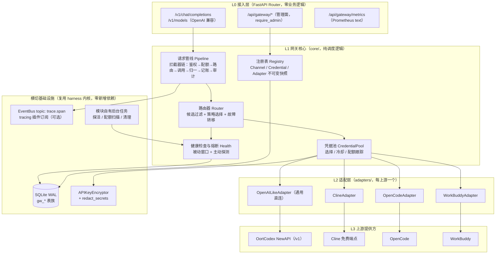
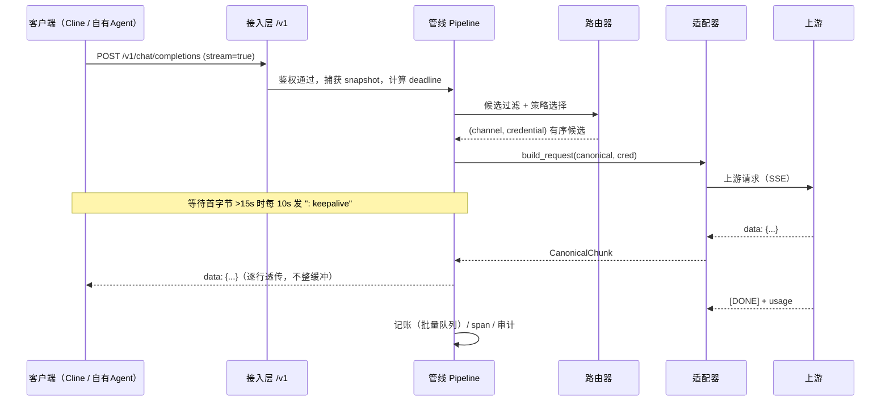
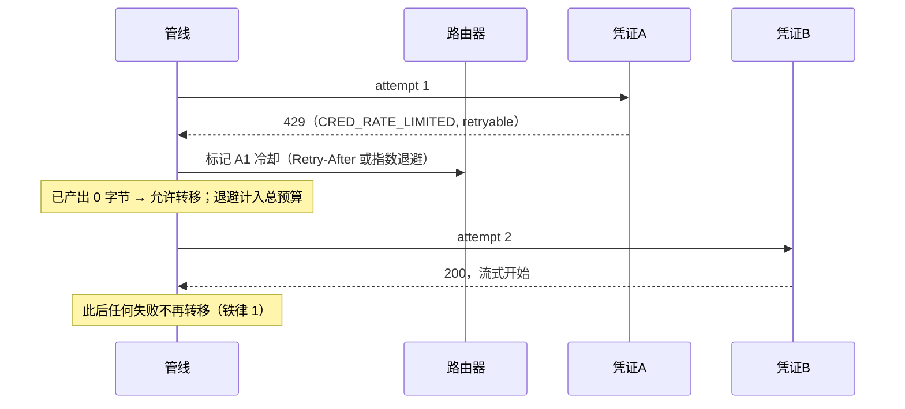
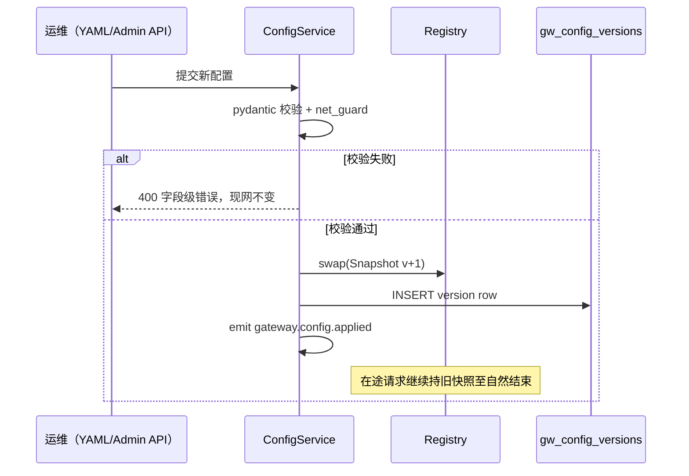
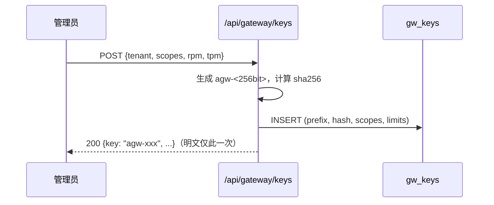

# andy-gateway —— LLM 网关中心设计方案

| 项 | 内容 |
|----|------|
| 文档版本 | v1.1（评审修订版） |
| 日期 | 2026-10-22 |
| 状态 | 评审通过待实施 |
| 模块定位 | `backend/harness/modules/gateway/`（内核模块，非独立服务） |
| 参考对象 | Magpie（多客户端免费额度聚合代理）、workbuddy2api-hub（WorkBuddy 多账号反代网关） |

> **v1.1 修订说明**：本版针对 v1.0 做了可落地性评审，修正 6 处与代码库事实不符的描述（装配方式、tracing 事件 topic、Scheduler 语义、鉴权中间件作用域、Key 编码、建表位置），补充 7 处设计缺口（总预算与断连、SSRF、配置单一写入口、凭据导入流程、指标基数、span 隐私、管理 API 清单）。逐条见附录 B。
>
> **实施进度（2026-10-22，含体检修订与竞品借鉴 P0）**：P0/P1 已落地于 `backend/harness/modules/gateway/`——`/v1` OpenAI 兼容端点、`openai-like` profile 适配器（Cline / WorkBuddy / Zen Free）、weighted/round_robin/least_inflight/least_latency/sticky 路由、熔断与故障转移、`agw-` Key + 租户白名单 + RPM/TPM + Key 轮换/吊销、用量批量落库与保留清理、审计、Prometheus 指标、配置版本化 + 2 秒热更新 + 回滚、主动健康探测（`probe_url`，判定分层）、SSE keepalive、请求总预算、凭据解析线程卸载。
>
> **故障语义精细化（竞品借鉴 P0，2026-10-22 落地）**：`classify.py` 纯函数失败分类（文本规则优先、kind×scope、429 指数退避 2s→5min、Retry-After 钳制 30min、未匹配 4xx 不冷却）；`HealthTracker` (channel, model) 双粒度熔断 + 退避等级（成功后归零）；`stream_rewrite.py` 流式 tool_calls 索引重编号 + 指纹工具抑制；纯思考空停一次性恢复（`defaults.empty_answer_recovery`，默认开）；`/v1/models` 按模型标注可用性（长冷却模型保留可见）。依据见 `docs/reports/andy-gateway-竞品与借鉴点分析-2026-10-22.md`。
>
> 前端管理台已落地：会话页工具箱 →「LLM 网关」进入 `/gateway`（`frontend/src/views/GatewayView.vue`），六个分区（通道与模型级可用性 / API Key 签发吊销轮换 / 租户 / 用量 / 审计 / 配置版本回滚），配套 `GET /api/gateway/models` 管理面模型级可用性端点。P2 部分完成：通道/凭据仍以配置文件 + 本机登录态为主，DB 版 Channel/Credential CRUD 与凭据导入 API 未做。Qoder CN 已接入（qoder-cosy 适配器：COSY 信封 AES-128-CBC+RSA-PKCS1+MD5 签名、私有 base64 body 编解码、agent_chat_generation SSE 信封解析、10605 排队→503 可重试），DNS 级 SSRF 待做。会话页作为第 4 个免费厂商「Qoder CN（免费）」出现，含 qfmodel/dfmodel 两个 price_factor=0 的免费模型。体检与修改记录见 `docs/reports/andy-gateway-代码体检报告-2026-10-22.md` 与 `docs/reports/andy-gateway-修改报告-2026-10-22.md`。

---

## 1. 背景与目标

### 1.1 问题背景

当前生态中存在一类"免费额度"资源：Cline、OpenCode、WorkBuddy（含 OortCodex NewAPI 10 元免费额度）等第三方客户端/平台各自提供可用的免费大模型额度，但存在三个共性问题：

1. **协议碎片化**：各家端点协议、鉴权头、身份校验、错误格式不同，无法被统一调用；
2. **额度孤岛**：单账号额度有限、易触发限流（429），多账号之间无调度，空闲与枯竭并存；
3. **接入成本高**：每个消费方（自有 Agent、Cline、OpenCode）需分别维护一套凭据与调用逻辑。

参考项目验证了该模式的可行性：workbuddy2api-hub 通过多账号池 + 身份头构造 + OpenAI 兼容反代，把 WorkBuddy 订阅额度封装为自托管 API。但其局限同样明显：**单一上游绑定、无多租户、无适配器抽象、计费视角单一**。andy-gateway 的目标是在 andy-harness 内核内做一个**通用化、可治理**的版本。

### 1.2 定位对比

| 维度 | Magpie | workbuddy2api-hub | **andy-gateway（本方案）** |
|------|--------|-------------------|--------------------------|
| 上游范围 | 多编码客户端 | 仅 WorkBuddy | 多提供方（适配器可扩展） |
| 协议 | OpenAI 兼容 | OpenAI 兼容 | OpenAI 兼容（枢轴）+ 内部归一化模型 |
| 路由策略 | 简单轮询 | 档位/冷却规则 | 轮询/加权/在途/健康/粘性，可组合 |
| 多租户 | 无 | 无 | 租户隔离 + API Key + 权限Scope |
| 可观测 | 面板日志 | 用量面板 | span + 指标 + 审计三件套 |
| 配置管理 | 静态 | 面板改 | 版本化 Schema + 热更新 + 回滚 |
| 部署形态 | 独立进程 | 独立进程 | 内核模块（预留独立进程拆出接缝） |

### 1.3 设计目标与非目标

**目标（按优先级）**：

1. 以 OpenAI Chat Completions 为枢轴协议，对外提供 `/v1` 兼容端点，**现有客户端零改造接入**（Cline / OpenCode / 任意 OpenAI SDK）；
2. 多上游、多凭据的池化调度：轮询、加权、健康检查、故障转移；
3. 多租户 API Key 治理：租户隔离、权限控制、凭据安全存储；
4. 全链路可观测：请求拦截、span、指标、审计；
5. 提供方与配置的动态扩展：适配器注册、配置热更新、版本管理。

**非目标（避免过度设计）**：

- 不做计费/支付系统（仅记录用量与等价估算，P5 再论成本控制）；
- 不做分布式集群（单节点 SQLite；但状态访问层预留 Redis 接缝）；
- 不自建前端面板（复用现有 Settings 页面，P3 挂一个面板入口）；
- 不实现"身份伪装"对抗层（合规边界见 §12；适配器只做协议翻译，不伪造客户端身份绕过风控——上游若要求特定身份头，由适配器配置项显式声明）。

### 1.4 非功能性目标（可验收）

单节点定位下，性能与可用性必须给出可测量的目标，否则"高性能/高可用"无法验收：

| 指标 | 目标 | 验证方式 |
|------|------|----------|
| 网关自身开销（不含上游） | 非流式 P99 < 15ms | FakeUpstream 压测 + span 阶段耗时分解 |
| 并发流式连接 | ≥ 200 路（单节点，不 OOM） | 压测脚本观察 inflight 与 RSS |
| 首字节等待 | 上游 > 15s 无数据时，每 10s 发 SSE 心跳，客户端不判超时 | 假上游延迟 60s 回包 |
| 故障转移时延 | 未产出字节场景 P95 < 300ms（不含退避） | 注入 429 / 连接拒绝 |
| 网关不可用时的降级 | Agent 侧可切回直连 provider 继续对话 | 停网关进程后切换 provider |
| 配置生效时延 | 文件源 ≤ 3s；Admin API 即时 | 改配置观察版本号 |
| 数据安全 | DB 无明文凭据/Key；日志与响应无密钥 | grep + 脱敏单测 |

> 说明：以上为**验收目标**而非压测承诺。单节点 SQLite 架构下，超过 ~50 QPS 需先评估写入与连接池瓶颈（见 §10）。

---

## 2. 总体架构设计

### 2.1 分层结构



**分层原则**：接入层只做协议解析与参数校验；核心层只做调度决策（不感知 HTTP）；适配层只做协议翻译（不感知租户/路由）；横切能力全部复用内核已有组件。依赖方向严格自上而下，`core/` 不 import `api/`，`adapters/` 不 import `core/`。

### 2.2 核心组件交互

| 组件 | 输入 | 输出 | 交互方 |
|------|------|------|--------|
| Pipeline | CanonicalRequest + 请求上下文 | CanonicalResponse / SSE 流 | Router、Adapter、记账、Span |
| Router | 请求（model/tenant/策略） | 有序候选列表（channel, credential） | Registry（快照）、Health |
| CredentialPool | 候选列表 | 单个可用凭据（解密后） | Crypto、DB（冷却/配额状态） |
| AdapterRegistry | adapter 名 | Adapter 实例 | 代码注册（`register_adapter`） |
| Health | 真实流量结果 + 定时探测 | 熔断状态（closed/open/half-open） | 后台任务、Registry |
| ConfigService | YAML / Admin API | 版本化不可变快照 | Registry、DB（版本表） |

### 2.3 两种消费路径与可用性降级

```
路径 A（自有 Agent 闭环）：
  AgentLoop → ProviderRegistry 注册 custom_andy_gateway
  （OpenAICompatibleProvider，base_url=http://127.0.0.1:8000/v1，api_key=agw-xxx）
  → 与调用 DeepSeek/Qwen 完全同构，模型列表出现 "gateway/*" 别名

路径 B（第三方客户端）：
  Cline / OpenCode / 任意 OpenAI SDK
  → base_url=http://<host>:8000/v1，api_key=agw-xxx
```

两条路径共用同一套路由、配额与审计；差异仅在 Key 的租户与 Scope 配置。

**可用性说明（单点 + 可接受降级）**：网关本身是单节点、无集群冗余。但它在 Agent 侧只是 `ProviderRegistry` 中的一个 provider——网关进程不可用时，Agent 可切回直连的其他 provider 继续工作；外部客户端可配置备用 `base_url`。这属于"故障可绕过"而非"网关自身高可用"，与个人/小团队定位匹配，不做双活集群。

---

## 3. 模块划分与职责边界

### 3.1 目录结构

```
backend/harness/modules/gateway/
├── __init__.py            # 导出公共服务契约
├── contracts.py           # CanonicalRequest/Response、GatewayError、适配器协议
├── service.py             # GatewayService 门面：装配、start()/stop() 生命周期
├── api/
│   ├── openai_compat.py   # /v1/chat/completions、/v1/models（setup_gateway_v1_routes）
│   └── admin.py           # /api/gateway/* 管理面（setup_gateway_routes）
├── core/
│   ├── pipeline.py        # 拦截器链 + 流式透传 + 超时预算 + 断连取消
│   ├── router.py          # 候选过滤 + 策略选择（纯函数式，便于单测）
│   ├── health.py          # 滑动窗口 + 三态熔断器
│   ├── registry.py        # Channel/Credential 注册表 + 不可变快照
│   └── config.py          # 配置加载、Schema 校验、版本化、热更新、单一写入口
├── adapters/
│   ├── base.py            # ProviderAdapter 抽象基类
│   ├── openai_like.py     # OpenAI 兼容上游通用适配器（P0）
│   ├── cline.py           # P4
│   ├── opencode.py        # P4
│   └── workbuddy.py       # P4
├── auth/
│   ├── keys.py            # agw- Key 签发/校验/轮换/吊销
│   └── tenants.py         # 租户 CRUD + 模型/通道白名单
├── credentials/
│   └── pool.py            # 凭据池：解密、选择、冷却、配额状态机
├── observability/
│   ├── metrics.py         # Prometheus text 渲染（零依赖手写）
│   └── audit.py           # 审计事件落库
├── usage/
│   └── writer.py          # 用量异步批量落库（单连接 SQLite 的必要缓冲）
└── store.py               # gw_* 表 SQL（建表统一登记在 infra/database.py）
```

**装配方式（与代码库一致）**：网关不是 `backend/plugins/` 下的可停用插件，而是与 `ProviderRegistry` 同级的常驻核心能力——在 `harness/main.py::_init_components()` 中实例化并 `_services.register(...)`，`GatewayService.start()` 在 lifespan 启动阶段拉起后台任务，`stop()` 在关闭阶段取消。这样 `/v1` 端点在所有部署形态下始终可用。

### 3.2 职责边界

| 模块 | 负责 | 明确不做 |
|------|------|---------|
| `api/` | HTTP 协议、参数校验、错误码映射、SSE 序列化 | 路由决策、协议转换 |
| `core/pipeline` | 拦截器编排、重试/转移决策、超时预算、断连取消 | 具体协议知识 |
| `core/router` | 候选过滤与策略选择算法 | 凭据解密、健康状态存储 |
| `core/health` | 熔断状态机、窗口统计 | 主动探测的调度（交给后台任务） |
| `core/registry` | 快照的构建与原子替换 | 配置校验（Config 负责） |
| `core/config` | Schema 校验、版本号、diff、热更新、唯一写入口 | 业务语义解释 |
| `adapters/` | 上游协议转换、错误分类、能力声明 | 多凭据决策、租户概念 |
| `auth/` | Key 生命周期、租户隔离、Scope 校验 | 上游凭据管理（属 credentials/） |
| `credentials/pool` | 凭据解密、冷却计时、配额跟踪 | 路由策略 |
| `observability/` | 指标、审计、span 发射 | 业务判断 |

**关键边界规则**：

1. 适配器是唯一允许 `import httpx` 发请求的层（连接池由适配器持有，见 §9）；
2. Router 只接收**不可变配置快照**（请求入口捕获 `snapshot = registry.current()`）；运行态（冷却、在途、熔断）按 credential/channel id 继承，不随快照替换丢失；
3. 管理面（`/api/gateway/*`）与数据面（`/v1/*`）物理分离：不同 Router、不同鉴权链（`require_admin` vs `agw-` Key）；
4. **配置变更单一写入口**：Channel/Credential/Key/Tenant 的所有增删改必须经 `ConfigService.mutate()`，禁止管理面直接写 `gw_*` 表（否则版本史与现网脱节，回滚会丢改动）；
5. `/v1/*` 不经过 `AuthMiddleware`（该中间件只保护 `/api/**`），因此数据面鉴权必须在网关内部强校验，不允许"本地环境默认放行"的例外。

---

## 4. 核心实现方案

### 4.1 归一化数据模型（Canonical Schema）

采用 **Hub-and-Spoke**：以 OpenAI Chat Completions 请求/响应形状为内部枢轴，所有适配器只做"边界翻译"（上游形态 ⇄ Canonical），路由与管线完全不感知上游差异。

```python
# contracts.py 要点
class CanonicalRequest(BaseModel):
    model: str                      # 客户端请求的模型名（可带 "gateway/" 别名前缀）
    messages: list[dict[str, Any]]
    stream: bool = False
    temperature: float | None = None
    max_tokens: int | None = None
    tools: list[dict[str, Any]] | None = None
    # —— 网关扩展字段（不透传上游）——
    tenant_id: str
    key_id: str
    session_key: str | None = None   # 粘性会话路由依据
    trace_id: str
    deadline_at: float               # 单调时钟下的请求总预算截止点（见 4.3.6）

class CanonicalChunk(BaseModel):
    delta: str | None = None
    tool_calls: list[dict] | None = None
    reasoning: str | None = None
    finish_reason: str | None = None
    usage: dict[str, int] | None = None

class CanonicalResponse(BaseModel):
    id: str
    model: str
    content: str
    tool_calls: list[dict] = []
    finish_reason: str = "stop"
    usage: dict[str, int] = {}

class GatewayError(Exception):
    code: str            # 统一错误码（见 4.2.4）
    http_status: int
    retryable: bool      # 是否可触发故障转移
    cooldown_scope: str  # "credential" | "channel" | "none"
    cooldown_seconds: int = 0
    upstream_status: int | None = None
```

**选型理由**：OpenAI 格式是事实标准，选它为枢轴可使 (a) 外部接入零改造；(b) 适配器逻辑最小化（多数上游只需字段改名/少数默认值注入）；(c) 未来新增 Anthropic/Gemini 上游时仍只加边界代码。

**模型名解析顺序**（避免"客户端名 / 通道映射名 / 上游名"三者混淆）：

```
1. 客户端请求 model（可带 "gateway/" 前缀，用于标识"走网关"）
2. tenant.allowed_models 校验（白名单或 "*"）
3. channel.model_map 映射为上游模型名（缺省同名）
4. 上游调用使用映射后名称；响应回写时统一还原为客户端请求名
```

### 4.2 适配器抽象

#### 4.2.1 接口定义

```python
# adapters/base.py
class ProviderAdapter(ABC):
    """上游协议适配器：Canonical ⇄ 上游形态。无状态，可多实例共享。"""

    name: str  # 适配器类型名，如 "openai-like" / "cline"

    @abstractmethod
    def capabilities(self) -> AdapterCapabilities: ...

    @abstractmethod
    def build_request(self, req: CanonicalRequest, cred: DecryptedCredential) -> UpstreamRequest:
        """Canonical → 上游请求（URL/头/体）。头内注入解密后的凭据。"""

    @abstractmethod
    def parse_response(self, body: bytes, cred: DecryptedCredential) -> CanonicalResponse:
        """上游非流式响应体 → Canonical。"""

    @abstractmethod
    def stream_chunks(self, lines: AsyncIterator[bytes]) -> AsyncIterator[CanonicalChunk]:
        """上游 SSE 行流 → CanonicalChunk 流（逐行解析，不整缓冲）。"""

    def normalize_stream_line(self, line: str) -> list[str]:
        """上游 SSE 行 → 标准 OpenAI SSE 行（默认原样透传，私有信封协议覆写）。

        网关对外 `/v1` 与进程内 provider 都假定流式载荷是 OpenAI 形状的
        `data: {chunk}`。Qoder COSY 的 `data:{"statusCodeValue":..,"body":"<chunk>"}`
        必须在此剥壳，否则客户端会拿到信封、表现为"提问后没有任何反馈"。
        返回 0..n 行；空列表表示丢弃（自定义 event / 元信息行）。
        """
        return [line]

    @abstractmethod
    def map_error(self, status: int, body: bytes) -> GatewayError:
        """上游错误 → 统一错误模型（决定重试/冷却语义）。"""

    @abstractmethod
    async def probe(self, cred: DecryptedCredential) -> bool:
        """主动健康探测（默认 GET /models，不消耗额度）。"""
```

> **实现现状（2026-10-22）**：`backend/harness/modules/gateway/contracts.py` 的 `ProviderAdapter` 已落地
> `capabilities / build_request / parse_response / aggregate_stream / map_error / probe / prepare / catalog_request / normalize_stream_line`。
> `_stream()` 在 ToolCallRewriter 之前逐行调用 `normalize_stream_line()`；归一化后的错误块（`data: {"error": ...}`）
> 发出后**立即终止流**——上游出错后往往不关连接，继续等会无限 keepalive，客户端表现为"永远转圈、没有任何反馈"。
> Qoder COSY 是首个覆写该钩子的适配器（信封剥壳 + `[DONE]` 规范化 + 丢弃 `event:finish`）。

#### 4.2.2 适配器注册（提供方注册机制）

```python
# adapters/__init__.py
_ADAPTERS: dict[str, type[ProviderAdapter]] = {}

def register_adapter(cls: type[ProviderAdapter]) -> type[ProviderAdapter]:
    _ADAPTERS[cls.name] = cls   # 重复注册覆盖（便于测试与适配器热替换）
    return cls

@register_adapter
class OpenAILikeAdapter(ProviderAdapter):
    name = "openai-like"
    # P0 即可对接 OortCodex NewAPI / DeepSeek / 任意 OpenAI 兼容端点
```

Channel 的 `adapter` 字段引用此注册名；**未注册的 adapter 名在配置校验期直接拒绝**（fail-fast，不留到运行时）。

**成本控制点（重要）**：若某上游仍是 OpenAI 兼容协议，只是路径/鉴权头/模型名不同，应优先使用 `openai-like` + Channel 配置（`base_url` / `headers` / `model_map`）解决，**不新增适配器类**。只有协议形态确实不同（如 Anthropic Messages、客户端私有端点）才写新适配器。这条规则用于抑制 P4 的适配器数量膨胀。

#### 4.2.3 协议转换与归一化

| 差异点 | 处理方式 |
|--------|---------|
| 路径不同（如 `/v1/messages` vs `/chat/completions`） | `build_request` 返回完整 URL |
| 鉴权头不同（Bearer / x-api-key / 自定义头族） | 适配器声明 `header_template`，凭据注入 |
| 消息格式差异（system 合并、reasoning 字段） | `build_request` 内做消息级变换；参考 `OpenAICompatibleProvider._build_request_body` 已有的 reasoning_content 剥离/回填逻辑 |
| 流式帧格式（SSE data: / NDJSON） | `stream_chunks` 内按行分发，输出统一 CanonicalChunk |
| 用量字段缺失 | 回落 tiktoken 估算（复用 `estimate_tokens`） |
| 模型名映射（上游模型名 ≠ 客户端请求名） | Channel 配置 `model_map: {请求名: 上游名}` |

**字段级映射（归一化契约）**：

| Canonical | OpenAI 兼容上游 | Anthropic 风格上游 | 客户端私有端点（Cline/OpenCode 类） |
|-----------|-----------------|--------------------|-----------------------------------|
| `messages` | 原样 | system 提取为顶层 `system` | 原样或包装为单条 prompt |
| `max_tokens` | 同名 | 同名（必填，缺省注入 4096） | 视端点，缺省注入 |
| `tools` | 同名 | 改名 `input_schema` | 通常不支持 → capability=false，收到 tools 直接拒绝（400） |
| `stream` | `stream=true` | `stream=true` | 视端点 |
| `usage` | `prompt_tokens/completion_tokens` | `input_tokens/output_tokens` | 按响应字段映射，缺失则估算 |
| `finish_reason` | 原样 | `stop_reason` 映射表 | 缺省 `"stop"` |
| `reasoning` | `reasoning_content`（DeepSeek 系）/ 无 | `thinking` 块 | 无 |

**能力声明是硬约束**：客户端请求了上游不支持的能力（如 tools），适配器必须在 `build_request` 前由 Router 过滤，返回 `GW_INVALID_REQUEST`，而不是转发后由上游报 400——错误更清晰，也避免无谓的额度消耗。

#### 4.2.4 统一错误模型

| 错误码 | HTTP | retryable | 冷却范围 | 典型上游信号 |
|--------|------|-----------|----------|--------------|
| `GW_INVALID_REQUEST` | 400 | 否 | none | 本地参数校验失败 |
| `GW_AUTH_FAILED` | 401 | 否 | none | `agw-` Key 无效/过期 |
| `GW_FORBIDDEN` | 403 | 否 | none | 模型不在租户白名单 |
| `GW_RATE_LIMITED` | 429 | 否 | none | 租户 RPM/TPM 超限 |
| `CRED_INVALID` | 502 | **是（换凭证）** | credential → 标记待人工复核 | 上游 401/403 |
| `CRED_RATE_LIMITED` | 429 | **是（换凭证）** | credential，取 `Retry-After` | 上游 429 |
| `CRED_QUOTA_EXHAUSTED` | 429 | **是（换凭证）** | credential 至配额重置点 | 上游额度耗尽信号 |
| `UPSTREAM_5XX` | 502 | **是（换通道）** | channel 熔断计数 | 上游 5xx |
| `UPSTREAM_TIMEOUT` | 504 | **是** | channel 熔断计数 | 读超时 / 首字节超时 |
| `UPSTREAM_UNREACHABLE` | 502 | **是** | channel 熔断计数 | 连接失败 |
| `GW_NO_CAPACITY` | 503 | — | — | 全部候选熔断/冷却 |

错误响应体统一为 `{"error": {"code", "message", "trace_id", "upstream_status"}}`，与 `harness.api.errors.APIError` 风格一致；所有消息经 `redact_secrets` 过滤并截断（上游 body 最多 2KB）后才可外泄（沿用 SEC-32 约定）。

### 4.3 统一请求路由与负载均衡

#### 4.3.1 两阶段路由模型

```
Phase A 候选过滤（硬性条件，布尔筛）
  channel.enabled
  ∧ request.model ∈ channel.models（支持 "*" 与 model_map）
  ∧ adapter.capabilities 覆盖请求所需能力（tools/vision/stream）
  ∧ tenant 策略允许（allowed_channels / allowed_models）
  ∧ channel 熔断器 ≠ open
  ∧ 存在 credential：status=active ∧ cooldown_until ≤ now ∧ 配额未耗尽

Phase B 策略选择（软性排序，按 channel.strategy）
  对每个 channel 独立选出有序凭证序列，得到有序候选
  （channel 之间按 weight 加权交错，形成全局 attempt 顺序）
```

#### 4.3.2 策略清单与适用场景

| 策略 | 算法 | 状态 | 适用场景 |
|------|------|------|----------|
| `round_robin` | channel 内原子计数器取模 | 无状态 | 同质凭证、额度相同的账号池 |
| `weighted` | nginx 平滑加权轮询（SWRR） | 轻状态（current_weight） | **主号+备用号**额度/质量不均（默认） |
| `least_inflight` | 选在途请求数最小者 | 计数器 | 长流式响应长期占用连接的场景 |
| `least_latency` | EWMA 时延最小（α=0.2） | 每凭证 EWMA | 上游质量波动大，需动态择优 |
| `sticky` | `hash(session_key) % n` | 无状态 | 多轮对话保持同账号（上下文一致/命中上游缓存） |
| `health_aware` | 综合分 = 健康度×w1 + 时延×w2 + 剩余额度×w3 | 复合 | 大规模池化后的统一策略（P5） |

**默认策略**：`weighted`。理由：免费额度的典型形态就是"一个主力号 + 若干备用号"，SWRR 既能按权重分配流量，又避免普通加权轮询的突发倾斜（连续 5 个请求全打主号）。

#### 4.3.3 路由与故障转移伪代码

```python
def order_candidates(snap, req, now) -> list[ChannelCandidate]:
    cands = []
    for ch in snap.channels:
        if not ch.enabled or not model_match(ch, req.model):
            continue
        if not tenant_allows(req.tenant_id, ch) or not caps_ok(ch, req):
            continue
        if snap.health.channel_open(ch.id):
            continue
        pool = [c for c in ch.credentials
                if c.status == ACTIVE and c.cooldown_until <= now and not c.quota_empty]
        if not pool:
            continue
        cands.append(ChannelCandidate(ch, order_by_strategy(ch.strategy, pool, req)))
    return interleave_by_weight(cands)      # 通道间按 weight 交错

def order_by_strategy(strategy, pool, req):
    if strategy == "weighted":       return smooth_weighted_round_robin(pool)  # 通道级锁保护
    if strategy == "round_robin":    return rotate(pool, next_counter())
    if strategy == "least_inflight": return sorted(pool, key=lambda c: c.inflight)
    if strategy == "least_latency":  return sorted(pool, key=lambda c: c.ewma_latency)
    if strategy == "sticky":         return stable_hash_order(pool, req.session_key)
    return pool

def smooth_weighted_round_robin(pool):      # nginx SWRR（单通道内）
    total = sum(c.weight for c in pool)
    for c in pool:
        c.current += c.weight
    best = max(pool, key=lambda c: c.current)
    best.current -= total
    return [best] + [c for c in pool if c is not best]

def execute(req):
    last_err = None
    for ch, cred in order_candidates(...)[: 1 + cfg.max_failovers]:
        if monotonic() >= req.deadline_at:          # 总预算耗尽，不再发起新尝试
            break
        try:
            return call_upstream(ch, cred, req)     # 首字节前失败才抛 retryable
        except GatewayError as e:
            last_err = e
            if not e.retryable:
                raise
            apply_cooldown(ch, cred, e)             # 冷却/熔断计数，见 4.3.4
    raise last_err or GW_NO_CAPACITY()
```

> 并发注意：SWRR 的 `current` 是共享可变状态，必须用**通道级锁**（或每通道单线程事件循环语义）保护；`inflight`/`ewma` 用原子增减与无锁读。

#### 4.3.4 健康检查

双源互补：

- **被动**：真实流量结果汇入 60s 滑动窗口（请求数、错误数、超时数），错误率 ≥ 50% 且样本 ≥ 5 → credential 熔断 30s；≥ 80% → channel 熔断 60s。
- **主动**：模块自有后台任务（随 `GatewayService.start()` 启动、`stop()` 取消；**不使用 `SchedulerService`**——后者面向用户可见的定时 Agent 任务，语义不匹配），默认 300s 调用 `adapter.probe()`；半开状态下单次探测成功即恢复。探测不消耗对话额度（GET /models 类端点）。
- **状态恢复**：熔断状态内存持有 + 变更时落库（`gw_credentials.status`），重启后从 DB 恢复，避免重启即全量冲击上游。

#### 4.3.5 故障转移语义（关键约束）

```
attempts = 1 + max_failovers（默认 2，即最多 3 次尝试）

铁律 1：已向客户端写出任何字节（首 token 已产出）→ 禁止换凭证/换通道重试。
        客户端已收到部分内容，静默重发会造成重复文本。
        此时仅允许同凭证重连，并复用 SEC-17 增量游标裁剪（_ResumeCursor 逻辑
        抽取至 gateway 复用，见 openai_compatible.py 既有实现）。

铁律 2：仅 retryable=true 的错误触发转移；CRED_INVALID / 配额耗尽属于
        "换凭证不换通道"，UPSTREAM_5XX / 网络错误允许换通道。

铁律 3：全部尝试失败 → 返回最后一次错误的 Canonical 形态（502/503），
        trace_id 必须回带，便于全链路定位。

铁律 4：重试不得突破请求总预算（见 4.3.6）；预算不足时直接返回当前最优错误。
```

#### 4.3.6 超时、总预算与断连处理

单次尝试超时与整体预算是两层概念，缺一不可——否则 3 次尝试 × 120s = 360s，客户端早已断开，且可能白烧三次额度：

| 层级 | 默认值 | 说明 |
|------|--------|------|
| `connect_timeout` | 10s | 建连；失败立即转移 |
| `read_timeout` | 90s | **流式语义为块间隔**（两块之间最大间隔），不是总时长 |
| `attempt_deadline` | 180s | 单次尝试总时长（含首字节等待） |
| `request_budget` | 240s（可由 `X-Gateway-Deadline` 下调，不可上调超过 600s） | 整请求含全部尝试；耗尽即返回最后错误 |

- **SSE 心跳**：等待上游首字节期间，超过 15s 无数据则每 10s 向客户端写一行 SSE 注释帧（`: keepalive`）。项目实测 DeepSeek/OpenRouter 首 token 可达 30–120s，无心跳会被客户端或中间代理判超时。
- **客户端断连**：检测 `request.is_disconnected()` 或生成器取消 → 立即 `aclose()` 上游响应，**停止继续消耗免费额度**；按已产出内容估算 usage，`status=client_aborted` 落库。
- **退避计入预算**：`1s→2s→4s`（封顶 15s）的等待时间从 `request_budget` 中扣除，预算不足时不再重试。

### 4.4 凭据池与配额治理

**实体模型**（三层，数据层只落两层）：

- `Adapter`（代码注册，非数据）——协议能力；
- `Channel`（DB 行）——一个可路由上游端点：adapter 名 + base_url + 模型集 + 权重 + 策略 + 健康配置；
- `Credential`（DB 行，归属 Channel）——单个账号凭据：密文 + 权重 + 状态 + 配额快照。

```python
class CredentialState(StrEnum):
    ACTIVE = "active"        # 可用
    COOLING = "cooling"      # 冷却中（cooldown_until 到期自动回 ACTIVE）
    REVOKED = "revoked"      # 人工吊销（上游 401 后的候选态，需复核）
    EXHAUSTED = "exhausted"  # 配额耗尽，等重置窗口
```

配额治理（对齐 workbuddy2api-hub 的经验，按阶段裁剪）：

- P1：被动记账——响应 usage 入 `gw_usage`，按 credential 聚合；
- P4（随第三方适配器）：主动探额——后台任务周期调用上游额度接口，刷新 `quota_json`（remaining/reset_at），`CRED_QUOTA_EXHAUSTED` 由适配器从响应信号判定；
- 429 处理：优先读 `Retry-After`，缺省按指数退避 1s→15s 封顶（与参考实现一致的经验值）；
- **超时的不确定性**：上游超时后无法确认是否已扣额度（对话接口非幂等）。处理策略：`UPSTREAM_TIMEOUT` 的尝试按"可能已消耗"计入配额估算（宁保守不超卖），但不阻塞下一次请求。

### 4.5 认证鉴权与多租户

#### 4.5.1 双平面鉴权

| 平面 | 端点 | 机制 |
|------|------|------|
| 数据面 | `/v1/*` | `Authorization: Bearer agw-xxx`（网关自签 Key，**始终强制**） |
| 管理面 | `/api/gateway/*` | 复用 `auth_manager`（`require_admin`） |

**两个必须写清的边界**：

1. `AuthMiddleware` 只保护 `/api/**`，`/v1/**` 天然不受其约束——数据面鉴权完全由网关自身实现，不做"认证关闭时放行"的例外；
2. `require_admin` 在 `HARNESS_AUTH` 未启用时**放行**（这是项目既有约定，本地单用户模式）。因此：**公网/局域网部署必须开启 `HARNESS_AUTH` 并设置管理员口令**，否则管理面（含凭据导入、Key 签发）处于开放状态。该要求写入部署检查清单。

#### 4.5.2 API Key 设计

```
格式： agw-<43 chars>（secrets.token_urlsafe(32)，base64url 字母表，256-bit 熵）
存储： sha256(key) 十六进制 + 前置索引 prefix（"agw-" + 前 8 字符）
校验： 按 prefix 取候选行（可能多行）→ 逐行 hmac.compare_digest(hash) 常量时间比对
       → 命中后校验 expires_at / revoked_at / scopes
展示： 仅创建响应返回一次明文；之后任何接口只返回 prefix + 元数据
轮换： rotate 生成新 Key，旧 Key 置 expires_at=now+24h（双活宽限期）后自动失效
```

**选型理由**：Key 为 256-bit 高熵随机串，无字典/彩虹表风险，SHA-256 足够；慢哈希（PBKDF2/bcrypt）只会给每次请求白送 100ms+ 延迟。口令类（管理面登录）才需要慢哈希——该能力 `infra/security.py` 已提供，直接复用。

**禁止事项**：不接受 `?api_key=` 查询参数（会进访问日志与代理日志）；仅接受 `Authorization` 头。

#### 4.5.3 租户与权限

```
Tenant ──1:N──→ GatewayKey ──1:N──→ Usage
   │                │
   │                └─ scopes: ["chat","models"] / ["chat","models","admin"]
   └─ allowed_models: ["*"] 或白名单；allowed_channels: ["*"] 或显式列表
```

隔离规则：

1. 每个 Key 归属唯一租户；每个请求上下文（`CanonicalRequest.tenant_id`）贯穿管线；
2. `gw_usage` / `gw_audit` 所有查询强制 `tenant_id` 条件（repository 层强制，不依赖调用方自觉）；
3. 限流计数按 Key 维度（RPM/TPM 令牌桶），租户维度汇总仅用于观测；
4. 跨租户访问返回 `GW_FORBIDDEN`，不泄露资源存在性；
5. `/v1/models` 按 Key 的租户白名单过滤后返回，不暴露其他租户可见的模型。

#### 4.5.4 上游凭据安全存储

- 加密：复用 `infra/crypto.py` 的 `APIKeyEncryptor`（Fernet，密钥由 machine-id 派生，**不落盘**）；
- 解密时机：仅凭据池选中该凭据时解密，明文仅存在于请求生命周期内的内存，**绝不入日志/响应/span**；
- 脱敏：所有错误消息、日志、span preview 统一过 `redact_secrets`；
- 多机部署预留（P5）：`GATEWAY_MASTER_KEY` 环境变量覆盖 machine-id 派生，实现跨机器可迁移；
- 导入自检：参考 workbuddy2api-hub 的 `unwrap_keyblob()` 自检思路——凭据入库前必须通过一次 `probe()` 或轻量校验，拒绝明显损坏的密文。

#### 4.5.5 凭据导入流程与出站安全（SSRF）

**导入流程**（明文只传一次，立即加密落盘）：

```
POST /api/gateway/channels/{id}/credentials
  { "label": "acct-1", "secret": "<token>", "weight": 1 }
  → 长度/非空校验（secret ≤ 4KB）
  → 可选 probe（默认开启，失败则拒绝入库或标记 unverified）
  → APIKeyEncryptor.encrypt() → gw_credentials.secret_encrypted
  → 响应仅返回 {id, label, fingerprint(sha256 前 8 位), status}
```

**出站安全**：

- Channel 的 `base_url` 与探测 URL 必须过 `infra/net_guard.py` 校验（仅 http/https、拒绝云元数据地址与非法端口）；
- 本地自建上游（127.0.0.1 的 Ollama / NewAPI）需要私网地址，采用**显式白名单**：Channel 配置 `allow_private: true` 或环境变量 `GATEWAY_ALLOW_PRIVATE_UPSTREAM=1`，默认关闭；
- `httpx` 设 `follow_redirects=False`，避免 302 跳出已校验的主机。

### 4.6 可观测性

#### 4.6.1 请求拦截（三层）

| 层 | 载体 | 职责 |
|----|------|------|
| 边缘 | FastAPI Middleware | 注入/透传 `trace_id`（无则生成），记录总时长、状态码、字节数；请求体大小上限（默认 8MB）与早期超时保护 |
| 管线 | `core/pipeline.py` 拦截器 | 逐阶段计时：queue/route/cred_select/upstream_ttfb/upstream_total/normalize |
| 上游 | 适配器内 | 单次 attempt 的请求/响应摘要（脱敏后） |

**span 接入方式（修正）**：tracing 是 `backend/plugins/tracing/` 插件，它订阅 EventBus 的 `trace.span` 事件并写 `SpanService`。网关以**事件方式**发布 `trace.span`（`kind="gateway"`，meta 携带 channel/credential_id/attempt/ttfb_ms），**不直接依赖 SpanService**——插件未启用时静默跳过，不影响请求链路。

**隐私约束**：网关 span 默认只记元数据（token 数、时延、错误码），**不记请求/响应正文**；确需排查时以 `GATEWAY_SPAN_PREVIEW=1` 开启 200 字脱敏预览。正文可能含用户数据与密钥，默认落库不符合最小化原则。

#### 4.6.2 指标（Prometheus text，手写渲染零依赖）

```
agw_requests_total{tenant,channel,model,status}
agw_request_duration_seconds{channel,model}          # 直方图，固定分桶
agw_upstream_ttfb_seconds{channel}                   # 首 token 时延（流式关键指标）
agw_inflight_requests{channel}                       # gauge
agw_failovers_total{channel,reason}                  # 故障转移计数
agw_credential_state{channel,credential,state}       # gauge
agw_quota_remaining{channel,credential}              # gauge（有配额信息时）
agw_tokens_total{tenant,model,type="prompt|completion"}
```

暴露于 `GET /api/gateway/metrics`（管理面鉴权）。**选型理由**：单节点场景手写 text format 约 150 行，引入 `prometheus_client` 依赖与项目"零新增依赖"风格不符；指标消费方（Grafana/Prometheus）无感知差异。

**基数控制**：`model` 取归一化后的上游模型名并设上限（50 个，超出归入 `other`）；`credential` 用短 ID（`cred_xxxxxxxx`）而非任何密钥片段；`tenant` 受租户数约束。防止标签爆炸拖垮指标端点。

#### 4.6.3 审计追踪

`gw_audit` 表 append-only（应用层无 UPDATE/DELETE 接口）：Key 签发/轮换/吊销、租户变更、Channel/Credential 增删改、配置版本应用/回滚、管理面敏感查询。每条含 actor、action、target、detail_json、trace_id、ts。配置类审计同时记录 config_version，实现"谁在何时把网关改成了什么样"的完整回溯。

> 诚实说明：append-only 是**应用层约束**，拥有 SQLite 文件写权限的人仍可直接改库。需要抗篡改时，后续可接 `modules/evidence_v2` 的哈希链思路（P5 评估），不在本期范围。

#### 4.6.4 全链路日志

结构化 stdlib logging（`harness.gateway` logger），固定字段：`trace_id, tenant_id, key_prefix, channel, credential_id, model, attempt, status, duration_ms, usage`。所有可能含凭据的字段过 `redact_secrets`。日志级别约定：转移/熔断=warning，配置应用=info，全部候选失败=error。**不记录消息正文**（排查靠 span 元数据 + trace_id 关联上游日志）。

### 4.7 动态扩展：注册、热更新、版本管理

#### 4.7.1 配置 Schema（YAML，pydantic 校验）

```yaml
# gateway.yaml（可被 Admin API 完全替代；两者写入同一版本表）
version: 3
defaults:
  strategy: weighted            # round_robin|weighted|least_inflight|least_latency|sticky
  max_failovers: 2
  request_budget_seconds: 240
  read_timeout_seconds: 90
  health_interval_seconds: 300
tenants:
  - id: default
    name: 本地默认租户
    allowed_models: ["*"]
channels:
  - id: newapi-main
    adapter: openai-like        # 必须已注册，否则校验期拒绝
    base_url: https://<oortcodex-host>/v1
    allow_private: false        # 本地 Ollama/自建 NewAPI 时才置 true
    enabled: true
    weight: 3
    models: ["qwen-plus", "deepseek-v3"]   # "*" 表示适配器声明的全部
    model_map: {}                          # {客户端名: 上游名}
    headers: {}                            # 额外静态头（不含密钥）
    extra_params: {}                       # 注入上游的默认参数
    credentials:
      - id: newapi-acct-1
        secret_ref: vault:gw/newapi-acct-1   # vault=加密存储；env:VAR=环境变量
        weight: 1
        quota: { daily_limit: 20, unit: "cny" }
    health: { interval_seconds: 300, probe: models }
  - id: cline-pool
    adapter: cline
    base_url: https://api.cline.bot
    weight: 1
    models: ["*"]
    strategy: least_inflight     # 通道级覆盖默认策略
    credentials: [ ... ]
keys:                            # 也可纯走 Admin API 动态签发
  - prefix: agw-xxxxxxxx
    tenant: default
    scopes: ["chat", "models"]
    rpm: 60
    tpm: 200000
```

校验规则（fail-fast，拒绝即整体不应用）：adapter 已注册；`secret_ref` 可解析；model 名非空；weight ∈ [1,100]；tenant 引用存在；同 channel 内 credential.id 唯一；`base_url` 通过 net_guard；`request_budget_seconds` ≤ 600。

#### 4.7.2 热更新机制

```
写入源（二选一或并存）：
  (a) gateway.yaml 文件监视：mtime + sha256 变化触发加载（轮询 2s，
      仅 GATEWAY_CONFIG_FILE 设置时启用，测试环境默认关闭）
  (b) Admin API：PUT /api/gateway/config（校验通过后直接进版本表）

应用流程（原子、在途安全）：
  1. parse + pydantic validate          —— 失败：整体拒绝，返回字段级错误，现网不变
  2. build new Snapshot(version=N+1)
  3. diff(old, new) → added/removed/changed（channel/credential 级）
  4. registry.swap(new)                  —— 不可变快照原子替换；
                                             在途请求持有旧快照引用，运行到自然结束
  5. pool.reconcile(diff)                —— 新凭据解密就绪；移除者标记 drained
  6. health.reconcile(diff)              —— 熔断状态迁移（保留未变更项的历史）
  7. persist version row + emit EventBus "gateway.config.applied"
```

**不可变快照**是热更新安全的核心：请求在入口 `snap = registry.current()` 一次捕获，后续路由/选 credential 全部基于 `snap`，与配置写入完全解耦——不存在"半个请求看到新配置、半个看到旧配置"。

**单一写入口**：Channel/Credential/Key/Tenant 的新增、修改、删除都必须经 `ConfigService.mutate()`（读当前快照 → 变更 → 校验 → apply → 落版本），禁止管理面直接写 `gw_*` 表。删除 Channel 时先置 `drained`（不再接受新请求），在途请求结束后再物理删除。

#### 4.7.3 版本管理与回滚

`gw_config_versions(version PK, payload_json, checksum, actor, source, applied_at)`：每次成功应用 +1；`POST /api/gateway/config/rollback {"version": N}` 等价于把版本 N 的 payload 重新走一遍应用流程（生成 N+1' 而非倒流版本号，保证审计线性）。`GET /api/gateway/config/versions` 列表 + `GET /api/gateway/config` 返回当前生效版本与完整快照（凭据密文以 `***` 脱敏）。

#### 4.7.4 管理面 API 清单

| 方法 | 路径 | 作用 |
|------|------|------|
| GET/POST | `/api/gateway/channels` | 通道列表 / 注册 |
| GET/PUT/DELETE | `/api/gateway/channels/{id}` | 通道详情 / 修改 / 下线（drain） |
| POST | `/api/gateway/channels/{id}/credentials` | 凭据导入（明文仅一次） |
| DELETE | `/api/gateway/credentials/{id}` | 吊销凭据 |
| GET/POST | `/api/gateway/keys` | Key 列表（仅 prefix）/ 签发 |
| POST | `/api/gateway/keys/{id}/rotate` | 轮换（24h 双活） |
| POST | `/api/gateway/keys/{id}/revoke` | 吊销 |
| GET/POST | `/api/gateway/tenants` | 租户管理 |
| GET/PUT | `/api/gateway/config` | 读取 / 整体替换配置（写版本） |
| GET | `/api/gateway/config/versions` | 版本列表 |
| POST | `/api/gateway/config/rollback` | 按版本回滚 |
| GET | `/api/gateway/metrics` | Prometheus 指标 |
| GET | `/api/gateway/usage` | 用量查询（tenant/key/channel/时间） |
| GET | `/api/gateway/audit` | 审计查询 |

除 `metrics`/`usage`/`audit` 为只读外，其余全部 `require_admin` + 审计留痕。

---

## 5. 关键业务流程

### 5.1 正常流式请求



### 5.2 故障转移（未产出字节 → 换凭证）



### 5.3 配置热更新



### 5.4 API Key 签发



---

## 6. 数据模型设计

表结构由 `modules/gateway/store.py::ensure_schema()` 在服务启动时创建（`CREATE TABLE IF NOT EXISTS` + 朴素列类型，与 `desktop_repeat/repository.py` 同模式，旧库自动升级）。

| 表 | 主键 | 关键字段 | 说明 |
|----|------|----------|------|
| `gw_channels` | id | adapter, base_url, allow_private, weight, strategy, models_json, model_map_json, headers_json, extra_params_json, enabled, health_json, drained | 可路由上游端点 |
| `gw_credentials` | id | channel_id(FK), label, secret_encrypted, weight, status, cooldown_until, quota_json, fail_streak, last_used_at | 单账号凭据；secret 为 Fernet 密文 |
| `gw_tenants` | id | name, status, allowed_models_json, allowed_channels_json | 租户 |
| `gw_keys` | id | tenant_id(FK), name, prefix, key_hash, scopes_json, rpm, tpm, expires_at, revoked_at, last_used_at | 网关签发 Key（只存哈希） |
| `gw_usage` | id (rowid) | ts, tenant_id, key_id, channel_id, credential_id, model, status, prompt_tokens, completion_tokens, duration_ms, ttfb_ms, attempt, trace_id, error_code | 用量流水；索引 (ts)、(tenant_id, ts)、(trace_id) |
| `gw_audit` | id (rowid) | ts, actor, action, target_type, target_id, detail_json, trace_id | append-only 审计 |
| `gw_config_versions` | version | payload_json, checksum, actor, source, applied_at | 配置版本史 |

**写入路径**：`Database` 为单共享连接（WAL + `busy_timeout=5000`）。`gw_usage` 不逐请求同步 INSERT，而是进入 `usage/writer.py` 的内存队列，按「50 条或 500ms」批量落库；进程退出时 flush。这避免高并发下写锁与 spans 表争抢（现有 `SpanService.record` 是逐条写，属已知瓶颈，不在本期改造）。

容量预估（单节点个人/小团队）：`gw_usage` 按 10 万行/天计，SQLite WAL 下索引查询毫秒级；保留 90 天，由模块自有后台任务每日清理（对齐 `HARNESS_SPANS_MAX` 的保留思路，不占用用户可见的 Scheduler 任务表）。

---

## 7. 与现有模块的集成点

| 现有模块 | 集成方式 | 阶段 |
|----------|----------|------|
| `harness/main.py` | 在 `_init_components()` 实例化 `GatewayService` 并注册到 `ServiceRegistry`；`start()/stop()` 挂在 lifespan | P0 |
| `model_manager` | 启动后向 `ProviderRegistry` 注册 `custom_andy_gateway`（OpenAICompatibleProvider → 本网关 `/v1`），自有 Agent 模型列表即出现网关通道 | P0 |
| `tracing`（`plugins/tracing`） | 发布 `trace.span` 事件（kind=gateway、仅元数据）；插件未启用时静默跳过 | P1 |
| `scheduler` | **不使用**：SchedulerService 面向用户可见的定时 Agent 任务（`scheduled_tasks` + TaskRunner），探活/清理属内部后台任务 | — |
| `auth_manager` | 管理面复用 `require_admin`；租户概念与用户体系解耦（网关面向机对机消费方） | P2 |
| `infra/net_guard` | Channel `base_url` 与探测 URL 的出站校验 | P2 |
| `insights` | 可选：注册 gateway 指标贡献者，进现有洞察看板 | P3 |
| 前端 Settings | 新增 Gateway 面板（Channel/凭据/Key/用量四个卡片），沿用 `style.css` 设计令牌 | P3 |
| `api/errors` + `api/deps` | 错误响应与鉴权依赖沿用既有约定 | 全程 |

---

## 8. 分阶段实施计划

按"可独立验收"切分，规模用 S/M/L 表示（S≈10-15 文件、M≈20-30 文件），不设虚假的日期承诺：

| 阶段 | 规模 | 目标 | 交付物 | 验收标准 |
|------|------|------|--------|----------|
| **P0 骨架与直连** | M | 打通"OpenAI 端点 → 单通道 → 上游"全链路 | `contracts` + `openai-like` 适配器 + `/v1/chat/completions`（流式/非流式）+ `/v1/models` + 环境变量单通道配置 + `GatewayService` 装配 + 注册 `custom_andy_gateway` | Cline 指向 `http://127.0.0.1:8000/v1` 成功对话；自有 Agent 选用 gateway 模型成功；直连 OortCodex NewAPI（用户已有额度）验证通过；`pytest tests -p no:randomly` 全量绿（1350 基线不破） |
| **P1 池化与韧性** | M | 多凭据调度与故障自愈 | CredentialPool + Router（weighted/round_robin/least_inflight/sticky）+ Health 熔断 + 故障转移 + 错误分类 + `gw_*` 持久化 + 内部探活任务 + 超时预算 + 断连取消 | 假上游"一号 429、二号正常"自动转移且客户端无感；杀上游进程验证熔断→半开→恢复；客户端中途断开后上游连接在 1s 内关闭；span 可见每次 attempt |
| **P2 多租户与安全** | M | Key 治理与凭据保护 | `agw-` Key 全套（签发/校验/轮换/吊销）+ Tenant + Scope + 白名单 + Fernet 加密凭据 + 导入 API（含 probe）+ net_guard + 审计表 + 基础 RPM/TPM 限流 | 跨租户访问 403 且不泄露存在性；DB 文件 grep 不到明文凭据；`http://169.254.169.254` 类 base_url 被拒；超限返回 429 带 `Retry-After` |
| **P3 可观测** | S | 看得全、查得准 | `/api/gateway/metrics` + 结构化日志 + usage/audit 查询 API + 配置版本 API + Settings 面板入口 | Prometheus 抓取成功；按 trace_id 还原一次请求全部 attempt 与耗时分解；指标标签数受控 |
| **P4 第三方适配器** | S-M/个 | 接入 Cline / OpenCode / WorkBuddy | 适配器（或 `openai-like` + profile 配置）+ 通道模板 + 契约测试 | 每适配器一套契约测试（正常/流式/错误映射/超时/能力缺失）；灰度开关可回退 |
| **P5 扩展增强** | 持续 | 成本与规模 | 语义缓存、成本报表、`health_aware` 复合策略、多节点接缝（Redis StateStore）、审计哈希链 | 见 §11 |

**P0 预演已完成**：本机 Cline / WorkBuddy / OpenCode Zen Free 三通道已通过 `tools/andy_gateway_lite.py` 实测（18 个免费模型可用，`free/auto` 故障转移生效），详见 `docs/andy-gateway-本机免费模型接入-v1.1.md`。**Qoder CN 已通过 `qoder-cosy` 适配器接入**（COSY 签名 + 私有 base64 body + 信封 SSE 归一化 + 排队 10605→503 可重试），四个免费通道均已可用。

**测试策略**：适配器与路由器全部可单测（`httpx.MockTransport` 造假上游；路由算法为纯函数，属性测试覆盖"熔断/冷却者绝不入选""SWRR 分配比例收敛"）；流式语义用异步迭代器造假 SSE 行，覆盖"首字节前失败可转移 / 首字节后失败不转移 / 客户端断开触发 aclose"。新增测试置于 `backend/tests/test_gateway_*.py`，遵守 1350 基线门禁。

---

## 9. 关键技术选型理由

| 决策点 | 选型 | 理由 | 被否决的备选 |
|--------|------|------|--------------|
| 部署形态 | 内核模块 `modules/gateway/` + `main.py` 装配 | 复用 ServiceRegistry/Database/EventBus，零新增运维单元；`/v1` 独立前缀预留拆出独立进程的接缝 | 独立微服务（运维成本、与内核重复造轮子） |
| 枢轴协议 | OpenAI Chat Completions | 事实标准；外部客户端零改造；适配器逻辑最小化 | 自定义 IR（每客户端都要写两次转换） |
| Web/HTTP | FastAPI + httpx（现有栈） | 异步流式天然契合；`httpx.AsyncClient` 连接池 + HTTP/2；与 `OpenAICompatibleProvider` 技术栈一致 | aiohttp（项目无使用先例） |
| 连接管理 | 进程级共享 `AsyncClient`（max_connections/per-host 限额） | 现有 provider 每次请求新建 client，网关场景下连接复用对 TTFB 收益显著 | 每请求新建（现有模式，不适合高频网关） |
| 路由状态 | 进程内存 + DB 恢复 | 单节点下内存状态延迟最低；熔断/冷却落库仅为重启恢复 | Redis（当前规模属过度设计；StateStore 接口预留） |
| 配置存储 | YAML + SQLite 版本表 | 人可读、可 git 管理；版本表提供审计与回滚；校验用 pydantic（已在依赖中） | etcd/consul（引入外部依赖） |
| 密钥加密 | Fernet + machine-id（`APIKeyEncryptor`） | 已落地验证；密钥不落盘；`redact_secrets` 配套防泄漏 | 自管 AES-GCM（重复造轮子且无收益） |
| Key 哈希 | SHA-256 + 常量时间比对 | 256-bit 高熵随机串无字典风险，无需慢哈希；避免每请求 100ms+ PBKDF2 | bcrypt（为低熵口令设计，用错场景） |
| 出站安全 | `infra/net_guard.py` + 私网白名单 | 复用既有 SSRF 防护；本地 Ollama/NewAPI 显式放行 | 自写 URL 校验（易漏） |
| 后台任务 | 模块自有 asyncio 循环（随 lifespan 启停） | SchedulerService 面向用户可见的定时 Agent 任务，语义不匹配 | 复用 SchedulerService（职责污染） |
| 指标 | 手写 Prometheus text | 零依赖；消费方无感知；标签基数可控 | prometheus_client（与零依赖风格冲突） |
| 追踪 | 发布 `trace.span` 事件 | 与 tracing 插件解耦，插件缺席不影响网关；泳道图零改造 | 直接依赖 SpanService（可选组件变硬依赖） |

---

## 10. 风险与权衡

| 风险 | 影响 | 缓解 |
|------|------|------|
| 上游 API 变动/风控升级（2api 类集成固有脆弱性） | 适配器突然失效 | 适配器版本化（`adapter_version`）；能力探测失败自动熔断而非硬错；降级路径=其他 Channel；修复只改适配器不动核心 |
| 流式故障转移语义复杂 | 重复文本/丢字节 | 铁律 1（产出字节后不转移）+ SEC-17 游标续传；契约测试覆盖"中途断流" |
| 超时后额度可能已被上游扣除（对话接口非幂等） | 配额虚耗/估算偏差 | 超时尝试按"可能已消耗"计入估算；不在超时后盲目重试同一凭证 |
| 客户端断连未及时取消上游 | 免费额度空转 | 4.3.6 断连检测 + `aclose()`；P1 验收明确覆盖 |
| 免费额度 ToS 合规 | 账号被封 | §12 使用边界；适配器不做身份伪造；探活走官方轻量端点 |
| 管理面在 `HARNESS_AUTH` 关闭时放行 | 局域网/公网暴露即失控 | 部署检查清单强制开启认证；默认只监听 127.0.0.1 |
| 单节点瓶颈（SQLite 单连接写、内存状态） | 高并发下延迟上升 | 定位 <50 QPS；usage 批量写；WAL + busy_timeout；StateStore 接口预留 |
| 配置误操作 | 全站路由错乱 | 校验 fail-fast + 版本回滚 + 单一写入口 + 审计留痕 |
| 密钥泄漏 | 上游账号被盗用 | 密文存储 + 脱敏日志 + Key 仅展示一次 + 轮换宽限期；泄漏响应=吊销 Key 不影响上游凭据（分层设计） |

---

## 11. 后续扩展建议

按 ROI 排序，均设计有挂载点，非现在做：

1. **限流细化**（P2 已含基础）：令牌桶 + 并发信号量双闸；租户级月度 Token 预算（超限降级到指定 Channel 而非直接 429）；TPM 需先估算后校正（响应 usage 回写差额）；
2. **响应缓存**：精确匹配缓存（hash(messages+model+temperature)）命中率最高的重复问答；语义缓存可复用 `memory_manager` 的向量检索能力，P5 评估；
3. **成本控制**：`gw_usage` 按渠道记录"等价金额"（参考 OpenRouter 估价），面板展示"本月免费额度消耗分布"；`cost_aware` 路由策略（优先消耗即将过期的额度）；
4. **模型别名与 fallback 链**：客户端请求 `gateway/auto` → 按延迟/健康动态选实际模型；请求 `gpt-4o-mini` 自动映射到可用的免费等价模型；
5. **凭据发现（可选）**：从本机已知配置路径**只读**读取客户端凭据（需用户显式授权），降低手工导入成本；明确不做进程内存扫描；
6. **多节点**：StateStore 接口切换 Redis（限流计数、粘性表、熔断状态共享）；网关无状态化（快照从 DB/配置中心加载）；
7. **审计抗篡改**：复用 `modules/evidence_v2` 的哈希链（`sha256(prev|seq|payload)`）对 `gw_audit` 做链式封装；
8. **告警**：Channel 全熔断、配额即将耗尽、异常 Key 签发时经 `channel_manager` 推送 Telegram/Webhook。

---

## 12. 合规与使用边界

1. 本方案定位为**个人/团队自用的额度聚合与统一接入工具**；使用各第三方平台免费额度须遵守其服务条款，违规风险由使用者承担；
2. 适配器仅做**协议转换**，不实现客户端身份伪造/风控绕过能力；上游若要求特定身份标识，必须在 Channel 配置中显式声明并自负其责；
3. 所有上游凭据属于敏感数据：加密存储、脱敏输出、最小化暴露（仅在请求内存中解密）为硬性要求，不随阶段裁剪。

---

## 附录 A：与参考实现的关键差异说明（为什么不全盘照搬 workbuddy2api-hub）

| 参考实现做法 | 本方案取舍 |
|--------------|------------|
| 进程内存扫描回收解密密钥（`wb_atrest`） | 不纳入：属入侵式手段，合规风险高；改为显式导入 + 自检 |
| 深度身份伪装（UA/会话头族/machineId） | 不纳入：适配器只做协议必需字段；身份头作为显式配置项而非默认行为 |
| 自动完成成长任务赚积分 | 不纳入：超出网关职责，且自动化任务有封号风险 |
| 单上游专用 | 通用化：适配器抽象 + Channel 实体，任一 OpenAI 兼容/私有协议上游均可接入 |
| 面板内嵌一切 | 收敛：数据面/管理面/观测分层，面板复用 andy-harness 现有 Settings |

---

## 附录 B：v1.1 评审修订记录

| # | 类别 | v1.0 问题 | v1.1 修正 | 依据 |
|---|------|-----------|-----------|------|
| 1 | 事实错误 | 称网关为"插件"、`activate/deactivate` 装配 | 改为 `main.py::_init_components()` 注册常驻服务，`start()/stop()` 挂 lifespan | `main.py` 实际装配方式 |
| 2 | 事实错误 | span topic 写成 `gateway.span`，正文另一处写 `trace.span` | 统一为发布 `trace.span` 事件（kind=gateway），tracing 插件缺席时静默 | `plugins/tracing/main.py` |
| 3 | 事实错误 | 用 `SchedulerService` 做探活/清理 | 改为模块自有后台 asyncio 任务 | Scheduler 面向 `scheduled_tasks` + TaskRunner，语义不匹配 |
| 4 | 事实错误 | 未说明 `/v1` 不受 `AuthMiddleware` 保护 | 明确数据面强制自建鉴权；管理面在 `HARNESS_AUTH` 关闭时放行的风险写入 §10 | `api/middleware/auth.py`、`api/deps.py` |
| 5 | 事实错误 | Key 格式写"base62"却又用 `token_urlsafe` | 改为 base64url（token_urlsafe(32)），并补充前缀碰撞处理 | `secrets` 语义 |
| 6 | 事实错误 | 未说明表结构登记位置 | 明确统一登记 `infra/database.py`（与现有 20+ 表一致） | `infra/database.py` |
| 7 | 设计缺口 | 无请求总预算，3 次尝试可能 360s | 新增 §4.3.6：connect/read/attempt/request 四层超时 + 预算耗尽即停 | 客户端超时与额度保护 |
| 8 | 设计缺口 | 无客户端断连处理 | 新增断连检测 + `aclose()` 上游 + `client_aborted` 记账 | 防止免费额度空转 |
| 9 | 设计缺口 | 无 SSRF 防护 | 新增 §4.5.5：net_guard + 私网白名单 + 禁止重定向 | 管理面可配任意 base_url |
| 10 | 设计缺口 | 配置可被 CRUD 旁路，版本史失真 | 新增"单一写入口 `ConfigService.mutate()`"边界规则与 drain 语义 | 版本/回滚一致性 |
| 11 | 设计缺口 | 凭据导入流程缺失 | 新增 §4.5.5 导入 API（明文一次、probe、指纹） | 可落地性 |
| 12 | 设计缺口 | 指标无基数控制 | 新增 50 模型上限、credential 短 ID | 防标签爆炸 |
| 13 | 设计缺口 | span 默认落正文有隐私风险 | 默认仅元数据，`GATEWAY_SPAN_PREVIEW=1` 才记 200 字脱敏预览 | 数据最小化 |
| 14 | 可落地性 | 阶段用"约 1 周"估算 | 改为 S/M/L 规模 + 可验收标准 | 避免虚假精度 |
| 15 | 可落地性 | 适配器可能为每个客户端都写一套 | 新增"OpenAI 兼容上游优先用 profile 配置"成本控制规则 | 抑制适配器膨胀 |
| 16 | 可观测性 | 缺管理面 API 清单 | 新增 §4.7.4 | 提供方注册/热更新可操作 |
