# andy-harness 用户使用手册

> 版本：**v1.0.x**（基于 v1.0.0 及 1.0.x 增量：工作流编排 / 模板中心 / 洞察看板 / 评测实验室 / 开发者工作台 / 集成中心 / 权限审计 / LLM 网关与四家免费模型）　|　编写日期：2026-10-14（2026-10-22 增补 §9.8）
> 适用对象：希望在**本机**搭建一个插件化 AI Agent 底座的开发者与使用者
> 手册中所有截图均取自当前版本实际运行界面（1440×900 视口，Windows 10，默认亮色主题，本机实拍）。

---

## 目录

1. [项目简介与适用场景](#1-项目简介与适用场景)
2. [环境要求与安装启动](#2-环境要求与安装启动)
3. [界面总览：首页与对话页](#3-界面总览首页与对话页)
4. [第一次对话（从零到出结果）](#4-第一次对话从零到出结果)
5. [会话管理（侧边栏）](#5-会话管理侧边栏)
6. [消息操作（复制 / 重答 / 追问 / 分叉 / 删除）](#6-消息操作复制--重答--追问--分叉--删除)
7. [设置页十一大标签详解](#7-设置页十一大标签详解)
8. [主题切换](#8-主题切换)
9. [1.0.x 新增能力：工作流 / 模板 / 洞察 / 评测 / 开发者工作台 / 浏览器自动化 / 录制回放 / LLM 网关与免费模型](#9-10x-新增能力工作流--模板--洞察--评测--开发者工作台--浏览器自动化--录制回放--llm-网关与免费模型)
10. [认证与多用户](#10-认证与多用户)
11. [进阶能力（REST API 入口）](#11-进阶能力rest-api-入口)
12. [常见问题排查](#12-常见问题排查)
13. [附录：环境变量与数据文件](#13-附录环境变量与数据文件)

---

## 1. 项目简介与适用场景

**andy-harness** 是一个**插件化 Agent Harness（智能体底座）**。它不是一个聊天机器人，而是一套把"让大模型稳定、安全、可观测地干活"工程化的框架：

- **插件化**：工具、技能、UI 扩展、接入渠道全部是插件，内核零业务逻辑；
- **可观测**：每次对话的模型调用与工具调用都落为 span 链（轨迹），能看到"哪里慢、哪里贵、哪里错"；
- **省 context**：工具超大输出自动落盘为「制品」，上下文只留摘要与引用；长期记忆按相关性注入；
- **可控**：工具按 只读 / 写操作 / 危险 分级，危险操作（如执行代码）默认弹窗要你点「允许」才运行；
- **可编排**：1.0.x 起提供 Dify 风格的可视化工作流画布、模板中心、洞察看板、评测实验室与插件开发者工作台。

**典型用法**：本机私有部署的 AI 助手底座、Agent 工程学习样本、插件/技能二次开发平台。
**默认部署形态**：单用户、本机访问，数据全部落在本机文件里，不依赖任何云服务。

---

## 2. 环境要求与安装启动

### 2.1 环境要求

| 组件 | 版本要求 | 说明 |
|---|---|---|
| 操作系统 | Windows 10（已验证） | macOS / Linux **尚未验证**，存在未知风险 |
| Python | 3.11+ | 后端 FastAPI |
| Node.js | **^20.19.0 或 >=22.12.0** | Vite 8 的硬性要求；Node 22.0~22.11 **不满足**，会启动失败 |
| 包管理器 | **pnpm**（必须） | 用 `npm install` 会导致锁文件不一致 |
| 浏览器 | Chrome / Edge 现代版本 | 访问 `http://localhost:5173` |
| 大模型 API Key | DeepSeek / Qwen / Doubao / 任意 OpenAI 兼容服务 | 深度调试过的模型是 DeepSeek `deepseek-v4-flash`；也可用 OortCloud 免费额度（见 [4.1](#41-第-1-步配置模型-provider)） |

### 2.2 三步启动（开发模式）

```bash
# ① 后端：创建虚拟环境并安装依赖
cd backend
python -m venv .venv
.venv/Scripts/python.exe -m pip install -e .        # Windows
# macOS/Linux 请用 .venv/bin/python -m pip install -e .

# ② 前端：安装依赖
cd frontend
pnpm install

# ③ 启动
# 方式 A：分别启动
cd backend  && .venv/Scripts/python.exe -m uvicorn harness.main:app --host 127.0.0.1 --port 8000
cd frontend && pnpm dev          # 默认 http://localhost:5173
# 方式 B（Windows 推荐）：仓库根目录一键启动
start-all.bat
```

> **访问地址必须用 `http://localhost:5173`**（前端 dev 绑定 IPv6，直连 `127.0.0.1` 可能不通）。
> 桌面壳（Tauri）用户直接双击安装包即可，无需上述步骤，详见 `desktop/README.md`。
> `start-all.bat` **不会自动安装依赖**，只复用已有的 `backend/.venv` 与 `frontend/node_modules`。

### 2.3 首次打开

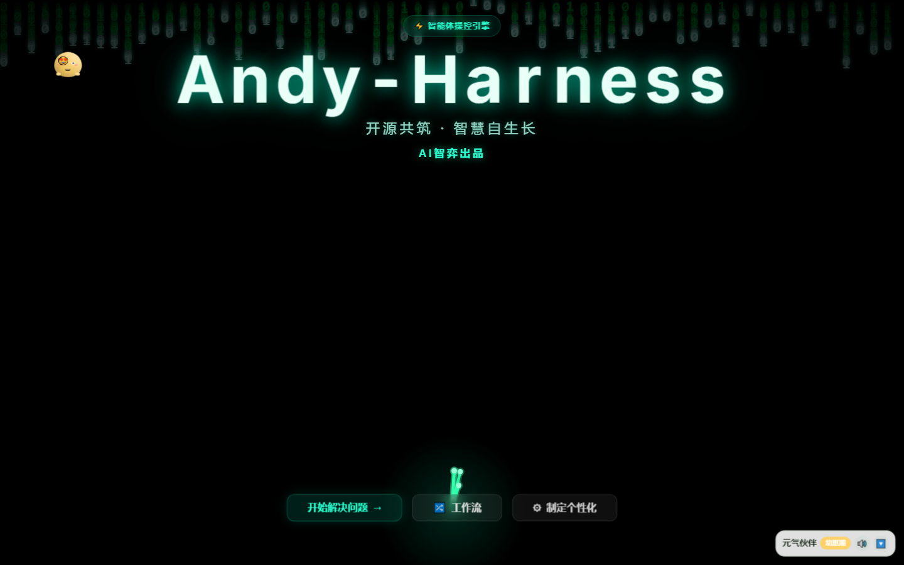

首页是极简的入口页：背景为「黑客帝国」数字雨动画，中部是项目名、一个**生成式思维树**组件（纯前端，无需模型），以及三个入口按钮——

- **开始解决问题**：跳转到 `/chat`，直接开始聊天；
- **🔀 工作流**：跳转到 `/workflows`，进入可视化编排画布（1.0.x 新增）；
- **⚙ 制定个性化**：跳转到 `/settings`，配置模型、插件、记忆等一切能力。

> 英文界面下分别为 **Start Solving** / **Workflows** / **Personalize**。

---

## 3. 界面总览：首页与对话页

### 3.1 对话页（空态）

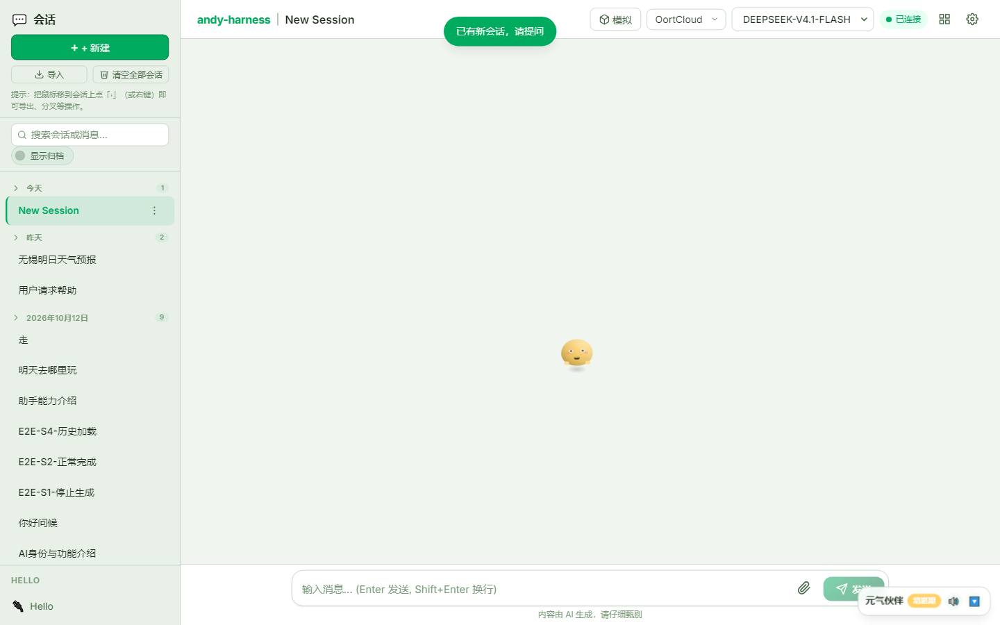

对话页分成三块：

| 区域 | 内容 |
|---|---|
| 左侧会话栏 | 新建 / 导入 / 清空、搜索框、按日期分组的会话列表 |
| 顶部标题栏 | 品牌名 + 当前会话标题；右侧是**模拟模式**开关、Provider 下拉、模型选择器、**工具箱**（洞察 / 评测 / 工作流 / 模板 / 开发者五个 1.0.x 功能入口）、连接状态徽章、设置齿轮（启用认证时还有「退出登录」） |
| 右侧主区 | 消息区 + 底部输入框 |

**连接状态徽章**有四种：`已连接` / `连接中...` / `重连中...` / `已断开`，对应 WebSocket 状态。若长时间「已断开」，说明后端未启动或端口被占（见第 12 节）。

### 3.2 对话页（有内容）

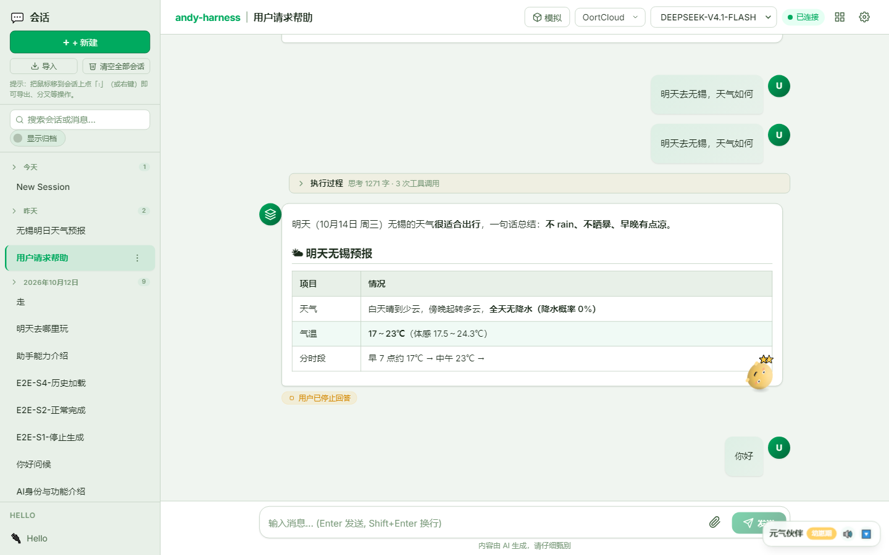

这张图展示了实际对话中的关键元素：

1. **AI 回答的工具调用过程框**（标题「执行过程」）：工具名、参数、结果逐条展开——这是「可观测性」的直接体现；
2. **Markdown 渲染**：代码块高亮、列表、加粗；流式输出实时渲染；
3. **每条回答下方的 token 用量**：`输入 X · 输出 Y · 合计 Z tokens`（含缓存命中/未命中）；
4. **思维链展示**：DeepSeek 推理模型的思考过程逐步展示，完成后自动折叠；
5. **底部输入框**：Enter 发送、Shift+Enter 换行；右侧 📎 添加附件、发送 / 停止生成按钮；内容超过 7 行时出现「放大输入框」；输入框下方常驻「内容由 AI 生成」合规标注条。

> 输入框**只支持点击 📎 选择文件**，不支持拖拽上传。

---

## 4. 第一次对话（从零到出结果）

### 4.1 第 1 步：配置模型 Provider

点顶部齿轮进入设置页，默认落在「模型」标签：

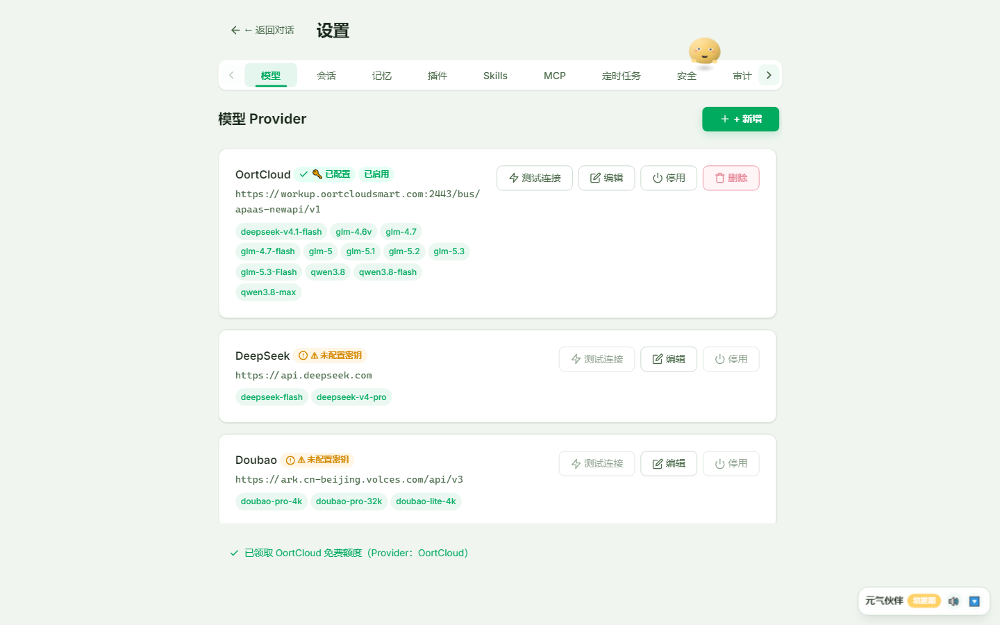

**方式一：自有 API Key**

1. 点 **+ 新增**，填写四项：
   - **名称**：自定义，如 `DeepSeek`
   - **Base URL**：如 `https://api.deepseek.com/v1`
   - **API Key**：密码框，填你申请的密钥
   - **模型列表**：逗号分隔，如 `deepseek-chat,deepseek-reasoner`
2. 点 **添加** 保存；
3. 回到列表点 **测试连接** → 显示 `✓ 连通` 或 `✗ 失败`；
4. 状态开关切到 **已启用**。

**方式二：不花一分钱（OortCloud 免费额度）**

配置表单下方有一张常驻的 OortCloud 推广卡片（未领取时才显示）。点 **免费领取** → 跳转 OortCloud 统一登录页授权 → 后端自动领取平台下发的 **10 元免费模型额度**（免费 NewAPI 令牌）并自动创建 `custom_oortcloud` Provider，回到会话里即可直接选用免费模型。**无需自有 API Key、无需付费**，足够把全部功能完整试一遍。领取流程带 state 防重放，令牌密钥本地加密存储。

**方式三：内置 LLM 网关的免费通道（需本机登录态）**

会话页 Provider 列表里已内置 **Cline / OpenCode / WorkBuddy / Qoder CN** 四个「（免费）」厂商，选中即可对话。它们复用**本机已登录的客户端登录态**（Cline CLI / Magpie），无需填写 API Key；前置条件、可用性检测与常见提示见 **§9.8**。

要点：

- 行内有 `🔑 已配置` / `⚠ 未配置密钥` 徽章；**未配置密钥时不能启用 / 测试 / 停用**；
- **编辑**时 API Key 留空表示「不修改」；
- **删除**只对自定义 Provider（`custom_` 前缀）可用，且已配置密钥且启用时置灰；
- Qwen / Doubao 内置插件**不支持**环境变量回退，请在设置页填写。

### 4.2 第 2 步：设置默认模型与温度

切到「会话」标签：

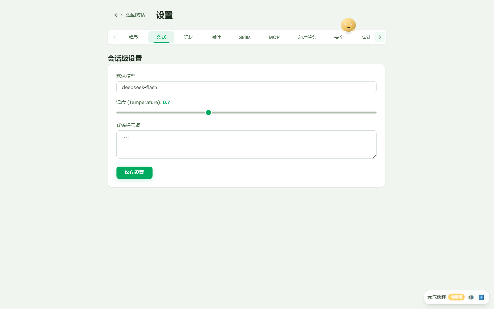

- **默认模型**：新会话使用的模型名（占位提示 `deepseek-flash`）；
- **温度 (Temperature)**：0–2 滑块，步进 0.1，实时显示数值，越高越发散；
- **系统提示词**：多行文本，作为该会话的系统指令；
- 改完点 **保存设置**（提示「设置已保存」）。

### 4.3 第 3 步：发消息

回到对话页，在输入框输入内容，**Enter 发送**（Shift+Enter 换行）。流式生成时输入框禁用，点 **停止生成** 可中断——中断后已生成的部分会完整保留为一条助手消息，并打上「用户已停止回答」标注；若中断时仅有思考链、尚无正文，思考过程会以可折叠块展示（见 [6](#6-消息操作复制--重答--追问--分叉--删除)）。

**没有 API Key 也能体验**：点顶部 **模拟模式** 开关（按钮变为「模拟中」），此时不消耗任何 token、不需要密钥，系统会用模拟回复演示完整交互流程。

### 4.4 附带文件（文档 / 图片）

点输入框 📎（title：`添加附件（文档 / 图片）`）选择文件：

| 限制项 | 数值 |
|---|---|
| 单次总文件数 | ≤ 8 |
| 文档 | ≤ 5 个，单个 ≤ 200KB（txt/md/csv/json/py/js/ts 等 26 种） |
| 图片 | ≤ 4 个，单个 ≤ 1.5MB（png/jpg/gif/webp/bmp，自动缩放控 token） |

文档内联为文本、图片按 OpenAI 视觉规范以 base64 注入模型。选错类型会提示「包含不支持的文件类型，已忽略」。已选附件以 chip 展示，可点 × 移除。删除会话会连带清理附件文件。

### 4.5 危险工具的人工确认弹窗

当 AI 要执行危险工具（如代码执行）时，会弹出确认框：标题「**AI 请求执行工具**」，展示**工具 / 原因 / 参数(JSON)**，底部两个按钮：**拒绝** / **允许执行**。超时未响应按**拒绝**处理。

策略可在「设置 → 安全」标签调整（见 [7.9](#79-安全工具权限与人工确认)）。

---

## 5. 会话管理（侧边栏）

| 操作 | 入口 | 说明 |
|---|---|---|
| 新建 | `+ 新建` | 存在空会话时会自动跳转并提示 |
| 导入 | `导入` | 选 `.json` 文件；缺 `messages` 字段会提示「不是有效的会话导出文件」 |
| 清空全部 | `清空全部会话`（有会话时才显示） | 确认「确定删除所有会话？此操作不可撤销。」 |
| 搜索 | 搜索框「搜索会话或消息…」 | 300ms 防抖，按标题或消息内容检索，显示命中徽章与片段，Esc 清空 |
| 归档切换 | `显示归档` / `隐藏归档` | 默认搜不到归档会话 |
| 重命名 | 双击会话项，或 ⋮ / 右键菜单 | |
| 导出 | ⋮ / 右键 → `导出` | 下载 JSON（含消息与任务清单），提示「已导出为 JSON 文件」 |
| 复制为新会话（分叉） | ⋮ / 右键 → `复制为新会话` | 提示「已分叉出新会话」，可安全试错 |
| 归档 / 删除 | ⋮ / 右键 | 删除需二次确认 |
| 分组 | 今天 / 昨天 / YYYY年M月D日 | 分组头可折叠 |

---

## 6. 消息操作（复制 / 重答 / 追问 / 分叉 / 删除）

把鼠标**悬浮**到消息上即可看到操作按钮：

**用户消息**
- **复制提问**：复制后提示「复制成功」3 秒；
- **删除本轮问答**：物理删除该提问及其回答（不可撤销）。

**助手消息**（有正文时）
- **复制回答**；
- **重新回答**：原位删除该轮并用原问题重新生成；
- **针对该回答继续追问**：进入追问模式，输入框上方出现引用条（显示「追问中」+ 原问题摘要，可「取消追问」）；
- **从此处分叉出新会话**：把该消息之前的历史复制为新会话。

每条助手回答下方还显示 **本次用量**（输入 / 缓存 / 未命中 / 输出 / 合计 tokens）。被「停止生成」中断的回答带「用户已停止回答」标注，位于内容下方；仅有思考链被中断时，思考过程以可折叠块渲染。

---

## 7. 设置页十一大标签详解

设置页顶部是一排标签，左右两侧有滚动箭头（标签多于一屏时）：`模型` / `会话` / `记忆` / `插件` / `Skills` / `MCP` / `定时任务` / `安全` / `审计` / `制品` / `通用`。左上角有「← 返回对话」。

> **与旧版的变化**：原「轨迹」标签已并入「审计」作为其子视图；「工具权限与人工确认」从「通用」拆分为独立的「安全」标签；「插件」标签内新增「智连器 / 赋能器」两个子页签。

### 7.1 模型（Providers）


新增 / 编辑 / 测试连接 / 启用·停用 / 删除，详见 [4.1](#41-第-1-步配置模型-provider)。OortCloud 免费额度领取入口也在本页（见 4.1「方式二」）。

### 7.2 会话


默认模型 / 温度 / 系统提示词，详见 [4.2](#42-第-2-步设置默认模型与温度)。

### 7.3 插件（智连器 / 赋能器）

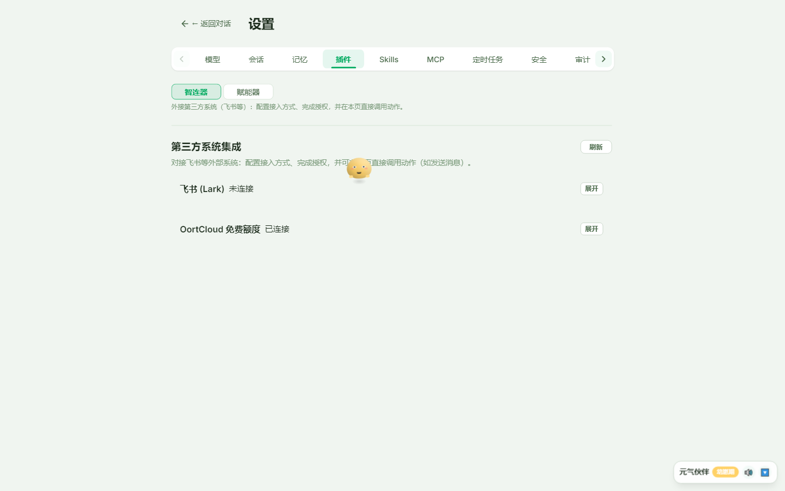

「插件」标签内部分为两个子页签：

**智连器（默认）** —— 接入第三方系统：

- **飞书**：三种模式任选——`api`（填 app_id / app_secret 直调开放接口）、`cli`（lark-cli 子进程）、`channel`（WebSocket 长连，群里 @机器人即答，需可选依赖 `lark-oapi`：`uv sync --extra feishu`）；
- **OortCloud**：免费模型额度领取入口（与「模型」标签的推广卡片同一能力）。

**赋能器** —— 本机能力插件：

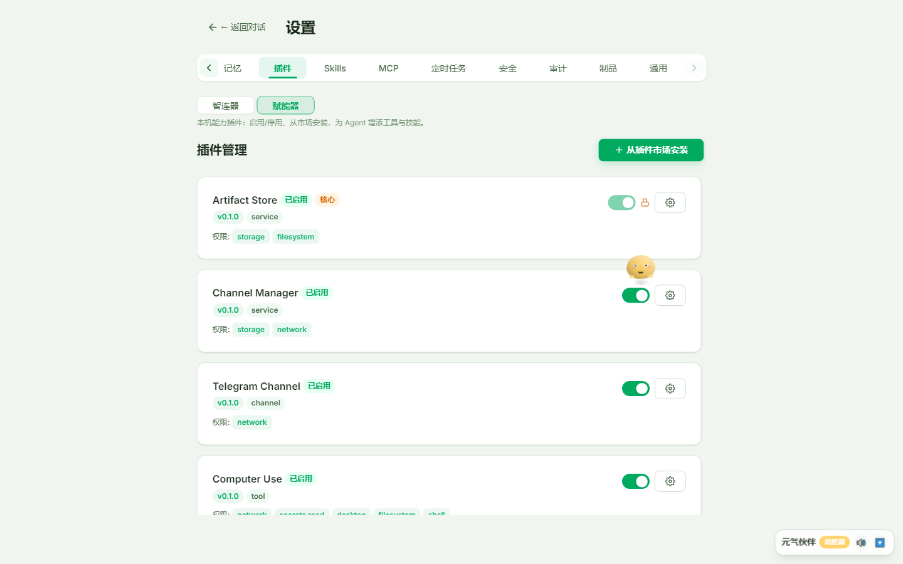

- **已装插件列表**：每行有 **启用/停用开关**（核心插件 `core` 锁定不可关，显示「核心」徽章）、**配置**（齿轮，按 schema 渲染表单，点「保存配置」）、**卸载**（仅市场来源插件，确认「此操作将删除插件文件，不可撤销。」）、权限标签与版本徽章；
- **从插件市场安装插件**：展开「插件市场」面板 → 每张卡片点 **说明** 看详情弹窗 → 点 **安装**（确认「确定从插件市场安装『名称』吗？」）→ 装好后卡片显示「已安装」徽章；
- 市场里还有**前后端联动**类插件（如元气宠物：后端启用后，会话页出现可走动、可喂食的悬浮宠物）；
- 从 UI 安装 / 停用插件即时生效，不需要重启后端。

### 7.4 Skills（技能）

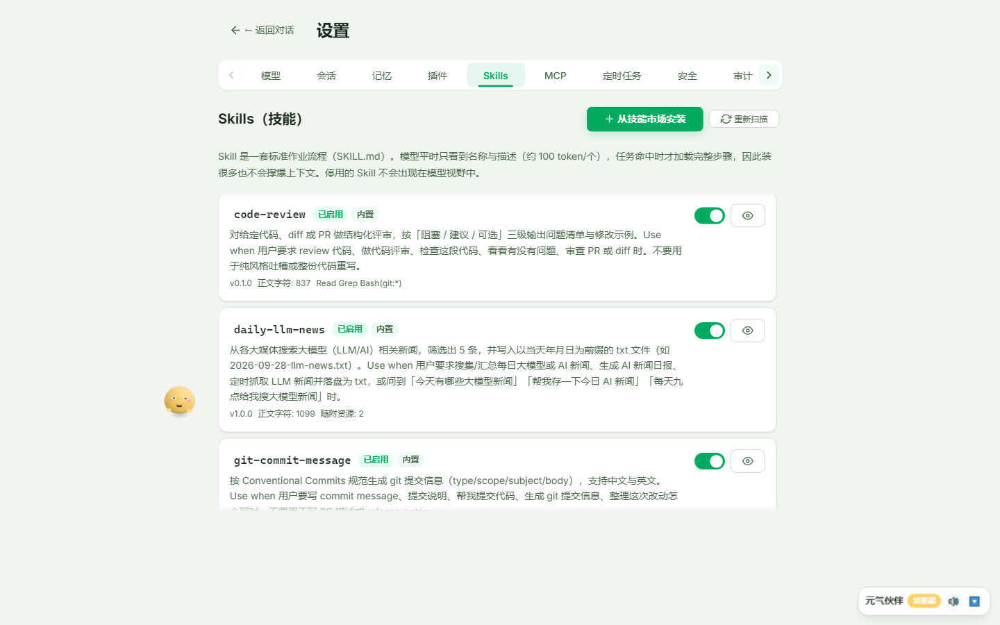

- 每行可 **启用/停用**（停用后不再进入模型视野），带来源徽章（内置 / 用户级 / 插件自带）、版本、正文字符数、资源数、`allowed_tools`；
- **查看详情**（眼睛图标）：弹出 SKILL.md 正文与随附资源列表——这就是"三级渐进式披露"：目录常驻、命中才加载正文、脚本与参考文档按需读取；
- **重新扫描**：重新扫描技能目录；
- **技能市场**：与插件市场共用面板，可一键安装 / 重装 SKILL.md 技能包。

### 7.5 MCP（接入外部工具生态）

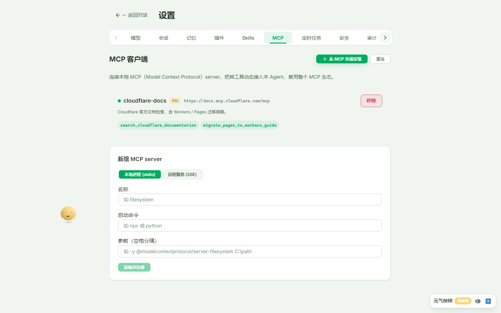

- **添加并连接**：
  - **本地进程 (stdio)**：名称、启动命令、参数（空格分隔）；
  - **远程服务 (SSE)**：名称、服务地址（SSE）、请求头（每行 `Key: Value`，可选）、描述（可选）；
- 列表项显示连接状态点（绿=已连 / 灰=未连）、类型徽章、命令或 URL、**工具 chips**（该 server 提供了哪些工具）；
- **重连** / **移除**（确认「确定移除该 MCP server (名称)」）；
- **MCP 市场**：与插件市场共用面板，可一键接入 libgen / deepwiki / context7 / cloudflare-docs / gitmcp 等免鉴权公开服务。

> 客户端同时兼容**旧版 SSE**（GET 建流）与 **streamable-http**（POST 直连），远端只支持其中一种时会自动适配。

**本地 vendored 服务：REA 逆向工程（`mcp_servers/rea`，含原生反编译）**

仓库内置了源码方式集成的 REA（Reverse Engineer Anything v6.4.0，MIT）MCP 服务，让 AI
在不看源码的前提下分析本地二进制与应用，结论附证据与局限，分析全程在本机执行。
**原生反编译已启用**：项目内隔离安装 Ghidra 12.1.4 + JDK 21（工作区 `.tools/`，不依赖
系统全局安装），可对原生 PE（x86/x64 的 exe/dll）输出**反编译伪代码**、汇编、函数清单、
字符串、调用关系与交叉引用；另有 JS/Electron、PE 资源、.NET 等引擎无关的静态分析。

- **构建**（干净克隆后执行一次）：`cd mcp_servers/rea && npm ci && npm run compile && npm run artifacts:skills`（要求 Node >= 22.19）；原生反编译另需按 [mcp_servers/README.md](../mcp_servers/README.md) 6.5 节准备 `.tools/` 内的 Ghidra/JDK；
- **注册**：`backend/mcp.json` 中的 `rea` 条目默认启用（本机为绝对路径，env 已含 Ghidra 配置；示例配置 `mcp.example.json` 用相对路径），重启后端或在「设置 → MCP」重连即生效；
- **三个 per-server 选项**（本机配置已使用，默认关闭不影响其它 server）：
  - `max_line_bytes`——REA 的 `tools/list` 单帧约 2 MB（170 个工具），超过 stdio 默认 1 MB 行上限，须调大为 16 MB，否则表现为"连接假死"；
  - `tool_allowlist`——工具白名单，本机收敛为 23 个工具（7 个静态分析 + 16 个 Ghidra 原生反编译族；全量 170 个工具注入会显著占用模型上下文）；
  - `request_timeout`——单请求超时 600 秒：Ghidra 冷启动（导入 + 自动分析）提供方截止即 330 秒，默认 60 秒会误杀长任务；
- **原生分析流程**：`open_binary`（导入目标，冷启动约 1~2 分钟）→ 函数/字符串清单检索 → `procedure_pseudo_code`（伪代码）/ `procedure_assembly`（汇编）→ 调用图与交叉引用；JVM 堆上限 `GHIDRA_HEADLESS_MAXMEM=3G` 控制内存占用；
- **完整说明与验证记录**见 [mcp_servers/README.md](../mcp_servers/README.md)。

**「工程强逆向」端到端逆向流水线**

把五类能力串成一条流水线，阶段之间以结构化事实流转，最终产出可离线校验的证据包：

| 阶段 | 能力 | 消费上一阶段的 |
| --- | --- | --- |
| REA 静态逆向 | PE 资源树、文件清单、字符串；深度反编译时输出伪代码/汇编/函数清单 | — |
| Frida MCP 动态插桩 | 受控运行目标，采集模块、内存特征命中、API 调用、退出码 | 静态发现的字符串（作为运行时内存扫描特征） |
| Firecracker 沙箱执行 | 微虚拟机强隔离执行（需 KVM）；不可用时降级为本地受限执行 | 样本路径与沙箱参数 |
| PentAGI 自动化分析 | 可疑 API、网络指示器、加密特征、注册表持久化、风险评分 | 上述全部 |
| Evidence v2 证据固化 | 哈希链防篡改证据包 + 人读报告，可随时离线校验 | 全部产物 |

- **入口**：会话页「更多功能」工具箱下拉中的 **工程强逆向**（与「工作流」同级）；
- **界面**：工具链体检（各阶段引擎可用性与降级原因）、启动流水线（填样本绝对路径 + 备注）、运行历史、阶段详情、Evidence v2 校验状态；
- **命令行**（不启动后端）：`cd backend && .venv/Scripts/python.exe ../rev_eng/tools/run_pipeline.py --subject <样本绝对路径>`，产物落在 `rev_eng/runs/<run_id>/`；
- **环境说明**：Firecracker 需 KVM、PentAGI 需 Docker，本机不满足时会自动降级为本地等价执行并在详情中标注原因；换到具备条件的环境无需改代码即可启用真实引擎；
- **完整说明与两轮验证**见 [工程强逆向-端到端集成总结.md](工程强逆向-端到端集成总结.md)。

### 7.6 定时任务

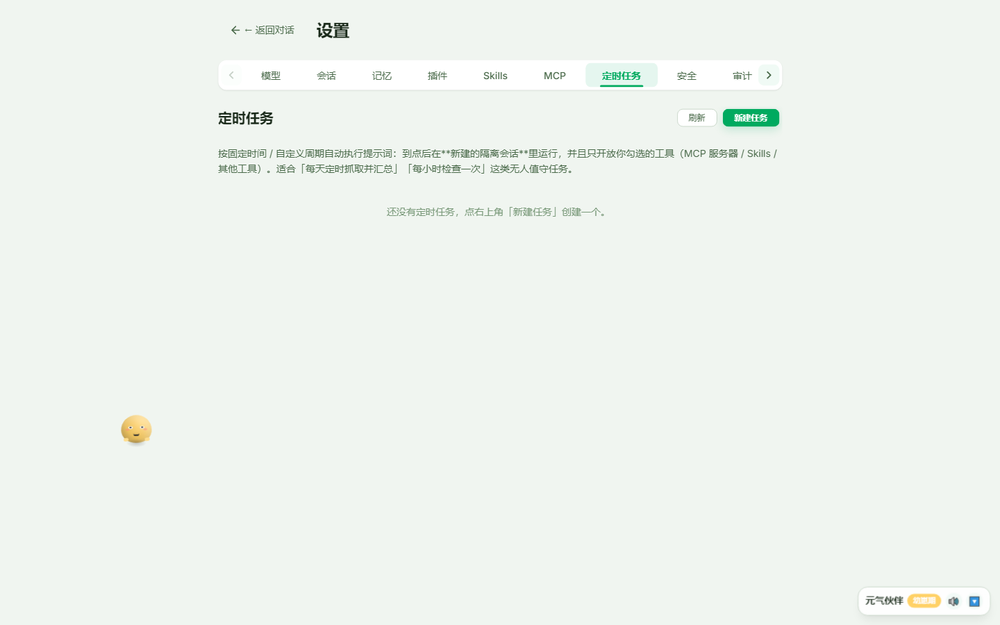

点 **新建任务**（或列表项 **编辑**）打开表单：

- **任务名称**、**任务说明**（可选）
- **调度策略**（四选一）：
  - `每天固定时间` → 选时间
  - `每周` → 选星期 chips（一~日，可多选）+ 时间
  - `固定间隔` → 每隔 [数字] + 分钟/小时
  - `一次性` → 执行时间（日期时间）
- **任务内容**：交给 AI 的指令（多行）
- **工具开放范围**（关键安全设计）：`可用的 MCP 数据源` / `可用的 Skills` / `其他可用工具` 三组多选 chips——**未勾选的一律不开放**，危险工具标红
- **模型服务** 与 **模型** 下拉（可 `自动（优先 DeepSeek）`）
- **运行上限**：最大工具迭代次数、超时（秒）
- **创建后立即启用** 复选项

任务列表每项：停用 / 启用 开关、**立即执行**、编辑、**运行历史**（展开看每次运行摘要/错误，触发来源标注 手动/定时）、删除；并显示「下次运行」时间与上次状态（成功/失败/已跳过/运行中）。

> 每个任务在**新建的隔离会话**中运行，任务工具集只含勾选的那些，避免越权。

### 7.7 记忆（长期记忆）

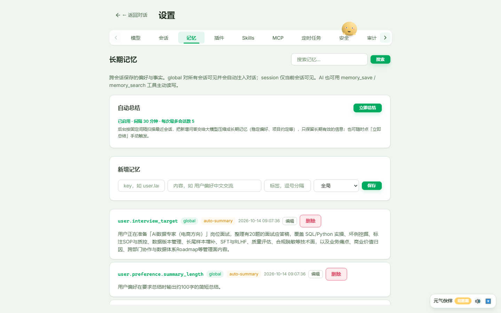

- **搜索**：输入关键词按「搜索记忆…」+ `搜索` 按钮（Enter 也可触发）；底层是余弦语义检索（默认零依赖离线 HashingEmbedder，配 `HARNESS_EMBEDDING_MODEL` 后走 OpenAI 兼容 `/embeddings`），无命中自动回退子串匹配；
- **自动总结卡片**：显示「已启用/已关闭 · 间隔 · 每次最多会话数」，可点 **立即总结**（按钮变「总结中…」，完成后提示「总结完成」）；
- **新增记忆**：key（如 `user.language`）、内容、标签（逗号分隔）、作用域（全局 / 会话）→ `保存`；
- 列表每行可 **编辑**（改内容与标签 → 保存/取消）与 **删除**（二次确认）；
- 总条数有上限（默认 10000 条，`HARNESS_MEMORIES_MAX` 可调），超出后按写入顺序环形淘汰最旧的记忆。

### 7.8 制品（大输出自动落盘）

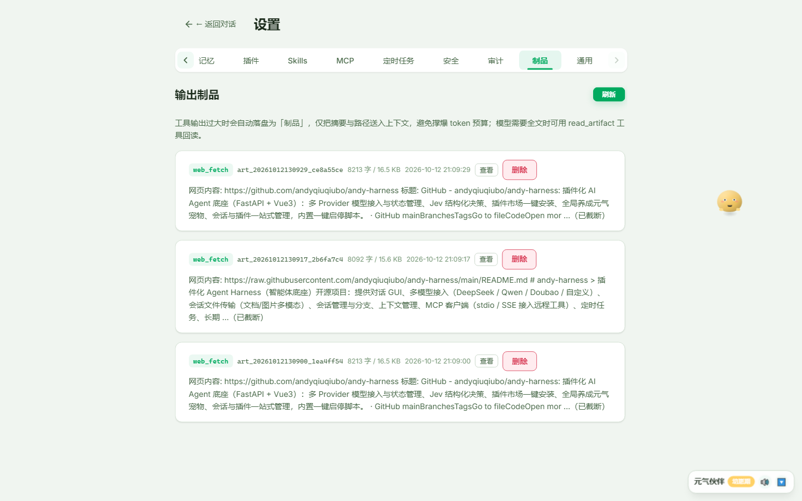

- 工具返回超大结果时自动落盘为「制品」，上下文只保留摘要与引用，避免撑爆 token 预算；模型可用 `read_artifact` 分页回读全文；
- 列表显示工具名、id、字数/字节、时间、摘要；
- **查看**：就地展开全文预览（不是下载）；**删除**：二次确认；
- 若插件未激活，会提示「制品服务未启用（artifact_store 插件未激活）」。

### 7.9 安全（工具权限与人工确认）

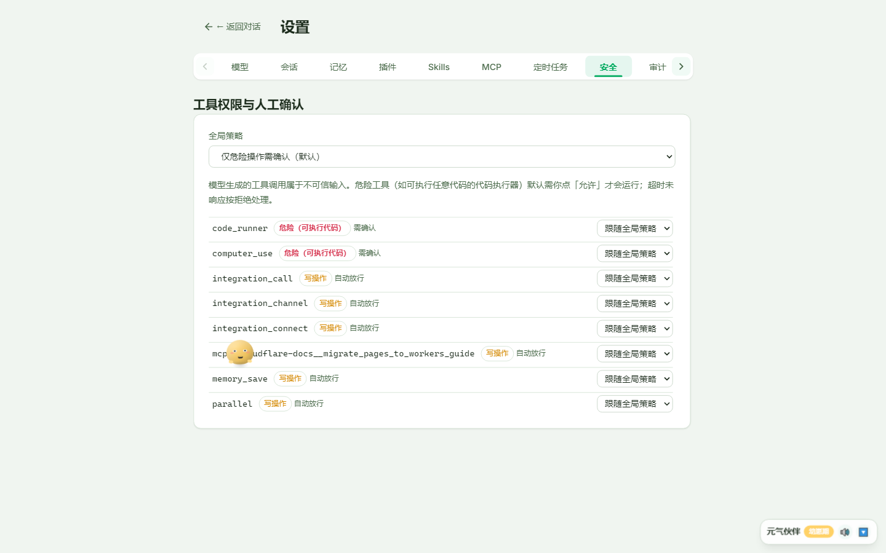

- **全局策略**下拉：`全部自动放行` / `仅危险操作需确认`（默认）/ `写操作与危险操作需确认` / `所有工具都需确认`；
- 下方每个已注册工具一行：风险徽章（只读 / 写操作 / 危险（可执行代码））+ 覆盖下拉（跟随全局策略 / 自动放行 / 需确认 / 拒绝执行）；
- 危险工具默认需你点「允许」才运行，超时按拒绝处理；
- 该页在未启用认证时始终可见；启用认证后仅管理员可改。

### 7.10 审计（运行轨迹 + 权限审计）

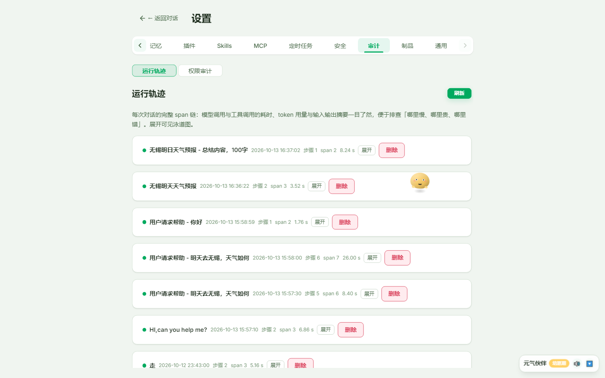

「审计」标签内分两个子页签：

- **运行轨迹**：每次对话的 span 链（模型调用 + 工具调用的耗时、token、输入输出摘要）落在这里；每个 trace 显示 span 数、步骤、token 用量、错误数，点 **展开** 查看**泳道图**与逐条 span 明细；支持 **刷新** / **删除**（二次确认）；
- **审计日志**：状态变更类操作（插件 / 技能 / MCP 安装卸载、权限模式与系统设置写入等）的流水记录，可按操作类型与时间筛选。

### 7.11 通用（主题 / 语言）

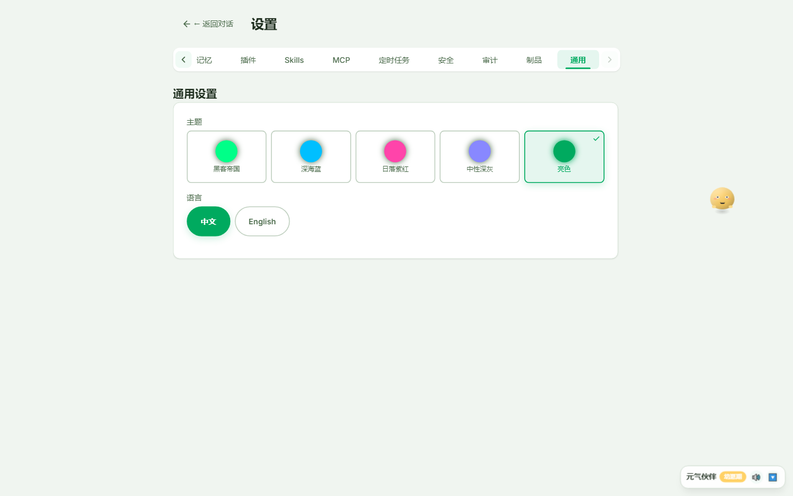

- **主题**：5 张卡片，点击即切换（选中打勾）——黑客帝国 / 深海蓝 / 日落紫红 / 中性深灰 / 亮色（默认）；
- **语言**：中文 / English。

---

## 8. 主题切换

在「通用 → 主题」点任意一张卡片即可立即换肤，选择会持久化（同时写本地与后端 `/api/settings`），刷新后保持。5 套主题各有侧重：**黑客帝国**（黑绿 + 首页数字雨）、**深海蓝**、**日落紫红**、**中性深灰**、**亮色**（默认，适合白天与投影）。

「中性深灰」主题下的首页与对话页：


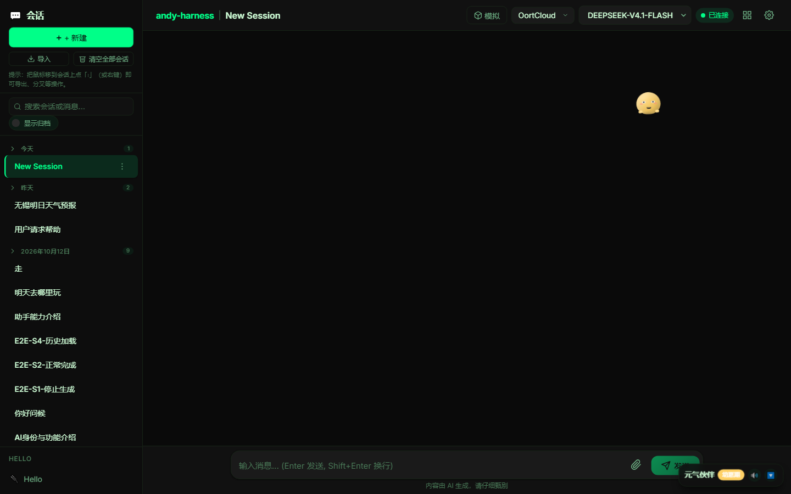

---

## 9. 1.0.x 新增能力：工作流 / 模板 / 洞察 / 评测 / 开发者工作台 / 浏览器自动化 / 录制回放 / LLM 网关与免费模型

这批能力统一从对话页顶部的**工具箱**（四格图标）进入，首页也有「工作流」直达入口。

### 9.1 工作流编排（Workflow Studio）

入口 `/workflows`。列表页点 **新建工作流** 进入画布：

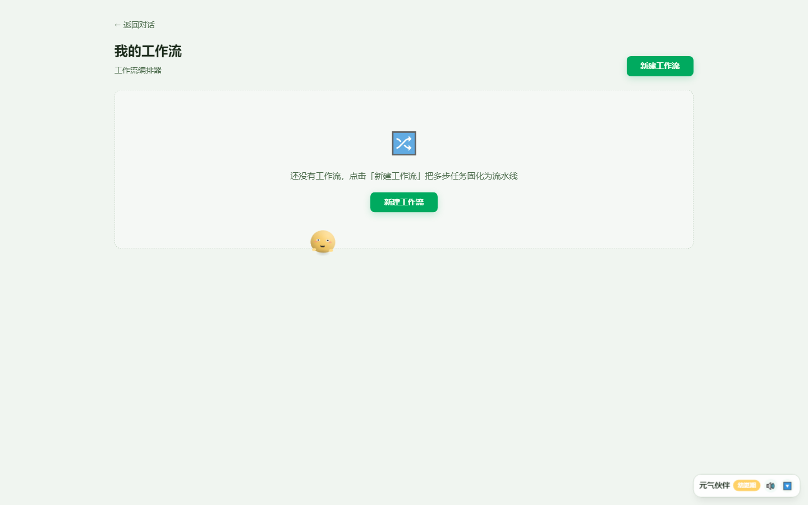

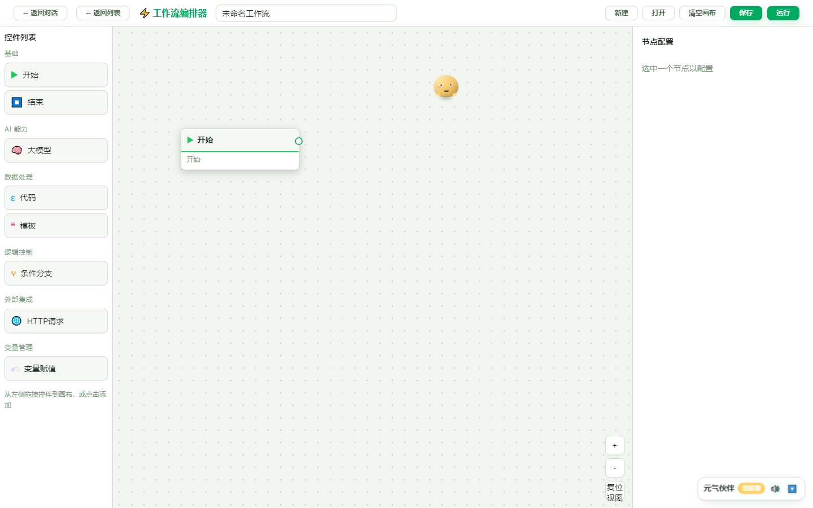

- **八类节点**：开始 / 结束 / LLM / 代码 / 条件分支（多条件 AND/OR）/ HTTP 请求 / 模板转换 / 变量赋值，全部对齐 Dify 的节点能力（温度等参数 / 重试间隔 / 超时 / SSL 校验 / 推理输出分离）；
- **画布操作**：从节点面板拖拽节点、拖动连线、平移缩放；LLM 节点的厂商选项只列出「已启用 + 已配 Key」的 Provider；
- **运行**：点运行后整流执行，运行面板可逐节点回看输入输出与耗时；
- 旧结构图（单条件分支）加载时自动迁移为新结构。

### 9.2 模板分享中心（Template Hub）

入口 `/templates`。集中管理**提示词 / 技能 / 工作流 / 会话包**四类模板：

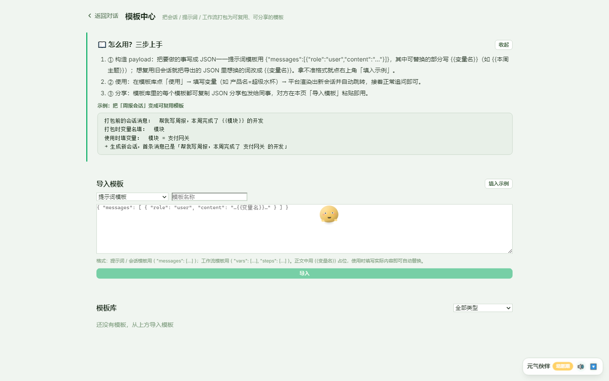

- **导入模板**（唯一创建入口）：选类型 → 填名称 → 粘贴 payload（JSON），可点「填入示例」看格式；带 `{{变量}}` 的模板在使用时会弹表单让你填值；
- **模板列表**：按类型筛选，每张卡片可一键 **使用**——提示词模板落地为新会话、工作流模板落地为可编辑的新工作流并跳转列表、会话包直接恢复历史。

### 9.3 洞察看板（Insights Dashboard）

入口 `/insights`：

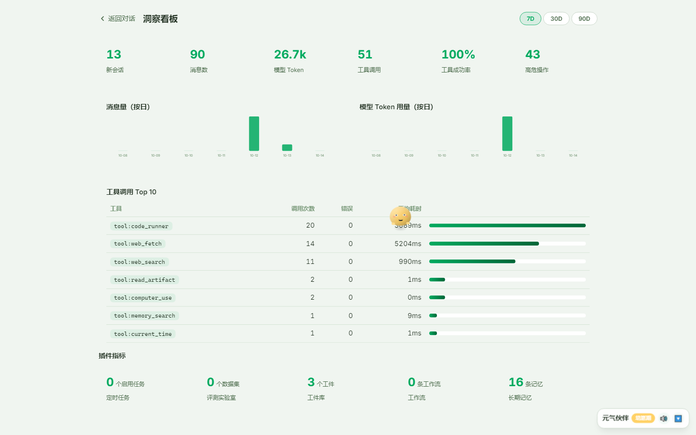

- **汇总卡片**：会话数 / 消息数 / Token 总量 / 工具调用数 / 工具成功率 / 危险操作数，可按时间范围切换；
- **工具统计**：各工具的调用次数分布；
- **插件自定义指标**：由插件贡献的指标卡（值 + 单位）也聚合在这里。

### 9.4 评测实验室（Eval Lab）

入口 `/evals`，做「模型 × 提示词」A/B 对比评测：

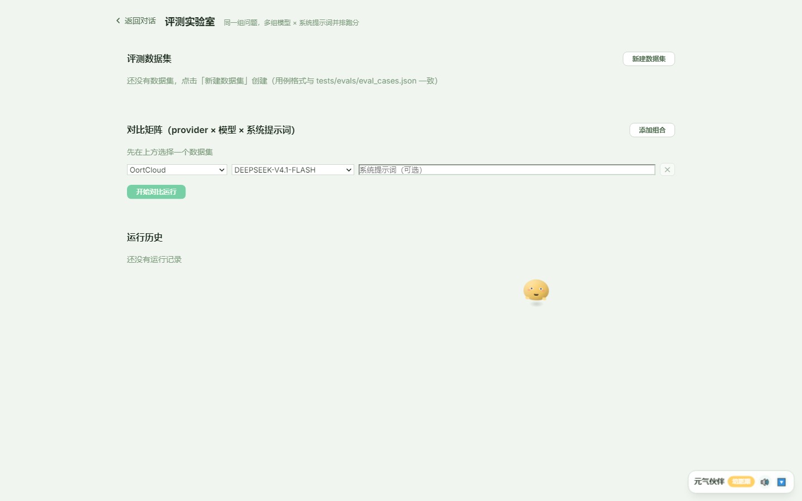

- **数据集**：新建 / 查看 / 删除评测用例集（可展开看每条用例的关键词、期望工具、禁用工具、迭代与耗时上限）；
- **对比矩阵**：添加多个 `Provider × 模型 × 提示词` 组合，一键运行，逐项客观打分（答案关键词 / 期望工具 / 禁用工具 / 迭代与耗时上限 / 无错误）；
- **聚合结果**：通过率、耗时、工具使用分布一目了然；
- 配套 CLI `python -m harness.eval --cases <file>` 可导出 JSON / Markdown 报告，失败退出码 1，可直接当 CI 门槛。

### 9.5 插件开发者工作台（DevKit）

入口 `/devkit`，面向二次开发者：

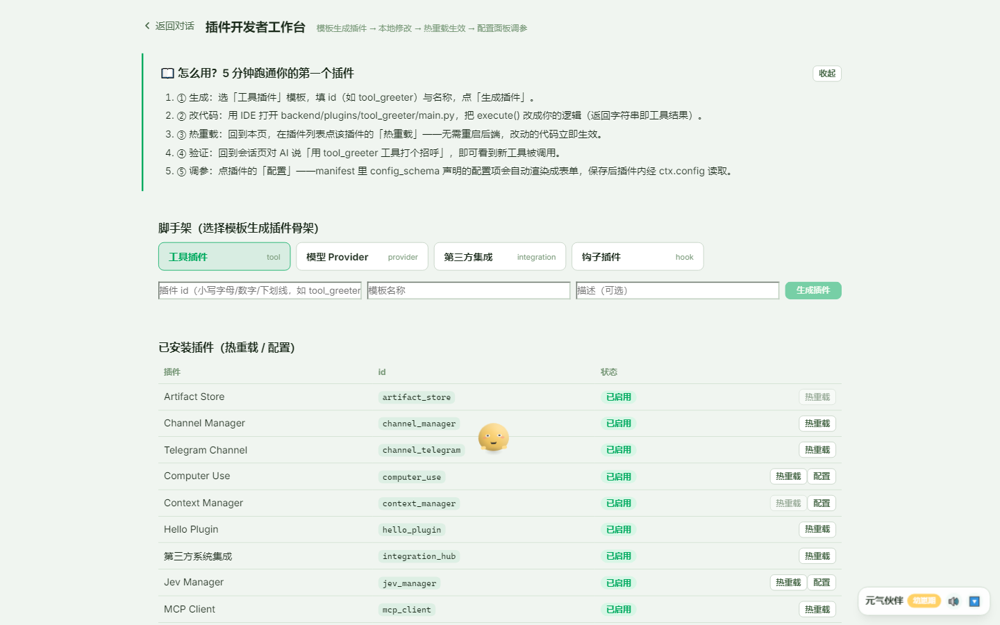

- **脚手架**：选模板（tool / provider / service 等）→ 填 id / 名称 / 描述 → 一键生成插件骨架，直接告诉你落在哪个目录、生成了哪些文件；
- **配置面板**：选一个已装插件，按其 schema 渲染表单，改完即存；
- **热重载**：对开发中的插件点「重载」，不用重启整个后端。

### 9.6 Browser Use 浏览器自动化（BrowserSkill）

> 让 AI **像人一样操作你已登录的 Chrome / Edge**：填表、点击、翻页、抓取、截图、借用/归还标签页。网页类需求会自动走这条路，不需要你指定工具。

**它是怎么工作的**

- 内置 [腾讯开源 BrowserSkill](https://github.com/Tencent/BrowserSkill) **v0.3.3**（MIT）官方技能包，位于 `backend/skills/browser-skill/`，来源、校验与本地改动记录在同级 `VENDOR.md`。
- 三件套版本需一致：**bsk CLI v0.3.3 + 浏览器扩展 v0.3.3 + 技能 v0.3.3**（通信协议 1.3）。
- 守护进程由后端自动托管：内置插件 `browser_daemon` 负责探测并在需要时拉起 `bsk daemon`（日志 `logs/browser-daemon.log`）。**你不需要打开终端执行任何 bsk 命令**——这是设计约束，不是可选项。

**第一次使用（只需做一次）**

1. **bsk CLI**：按官方 install 命令安装 v0.3.3（技能正文有命令与直链）。
2. **浏览器扩展**：扩展商店在中国大陆通常不可达，此时用官方离线包：已代下载并校验的 `ext-v0.3.3` 位于 `D:\browser-skill-extension\v0.3.3`。在 Chrome 打开 `chrome://extensions` → 打开「开发者模式」→「加载已解压的扩展程序」→ 粘贴上述路径。Edge 同理。
3. **技能**：已内置，设置 → Skills 里可查看/启停。

**日常用法**：直接在对话里说「打开 example.com 总结页面」「抓取某后台最近 10 条数据整理成表格」。已登录状态会被复用（无需重新登录），会话窗口**默认置顶显示**（`--focus`），你能直接看到操作过程。

**几个要知道的边界**

- 借标签页、验证码、登录等涉及人工的环节会明确请你确认/接管，不会擅自操作。
- `chrome://` 开头的页面、扩展安装页**无法被自动化**（浏览器安全限制），只能手动。
- 单次任务的模型调用预算已提高到 25 轮；搜索类需求直接给结果页 URL（如 `www.baidu.com/s?wd=关键词`）能显著更快完成。
- 若抓图失败但文字正常，多半是扩展版本低于 0.3.3，按第 2 步升级即可。

### 9.7 操作录制回放（andy-repeat）

> 把「在电脑上演示一遍」录成**可编辑、可复用、零 token 回放**的流程。核心是**录事件流而非录像素**：录制时取证每个点击落点的控件语义，回放时按定位链确定性地还原，**主路径不调用大模型、断网也能跑**。

**五步工作流**（入口：更多功能 → 操作录制回放，即 `/repeat`）

| 步骤 | 做什么 | 关键点 |
|---|---|---|
| ① 录制 | 点「开始录制」，把流程完整演示一遍 | 输入密码/敏感窗口会自动暂停或脱敏 |
| ② 解析 | 停止后自动解析为结构化步骤 | 每步带定位链与置信度，`needs_review` 的需人工确认 |
| ③ 发布 | 发布为工作流，可在画布上编辑 | 与 Workflow Studio 同一画布，`gui` 节点可增删改 |
| ④ 干跑 | 零副作用体检：只解析定位、不注入 | 先看这一步能过，再真跑 |
| ⑤ 回放 | 真执行，实时进度走 SSE | 支持断点续跑、人工裁决、紧急停止 `Ctrl+Alt+.` |

**安全与隐私**：敏感窗口自动暂停、密码框内容永不记录（回放时转人工输入）、越界窗口与危险动作硬拦截。

**鲁棒性（近期修复）**：应用内弹出的**模态对话框**（如「另存为」）会被自动接管并继续回放，不会把回放锁死；弹窗标题与录制时不一致时，以窗口 class 精确命中作为强证据放行；新窗口/对话框弹出慢会等待其出现（默认 2.5 秒）；`hotkey` 步骤定位链耗尽时自动降级为焦点注入（例如"输完网址按回车后页面才跳转"这类因果倒置场景），无需重新录制。

**可选：视觉辅助核对**（`repeat.vision_enabled`，默认关）— 解析完成后异步调用视觉理解模型（默认百炼 `qwen3-vl-plus`）逐步比对前后帧，回答「这一步做了什么 / 画面是否变化 / 是否生效」，产出疑似未生效清单，供人工复核。纯旁路，失败不影响录制与回放。

**详细操作**（含全部热键、错误码速查、CLI 用法）见 [`docs/manual/andy-repeat-录屏回放用户操作手册.md`](manual/andy-repeat-录屏回放用户操作手册.md)。

### 9.8 LLM 网关：官方免费额度（主线）+ 客户端免费通道（可选）

> 网关把多个模型来源统一成 **OpenAI 兼容接口**：会话页可直接选用，也可作为 `/v1` 服务供任意 OpenAI 客户端调用。

**两类来源（默认配置）**

| 类型 | 通道 | 需要准备 | 默认 |
|---|---|---|---|
| 官方 API（**主线**） | Qwen 百炼 / 豆包方舟 | 环境变量 `DASHSCOPE_API_KEY` / `ARK_API_KEY` | 启用，配好 Key 即出现在模型列表 |
| 客户端登录态（可选增强） | Cline / WorkBuddy / Qoder CN | 见下方前置条件表 | 默认关闭 |
| 匿名免费 | OpenCode Zen Free | 无（上游已收紧免费档） | 默认禁用 |

**三条使用路径**

| 路径 | 适合谁 | 怎么做 |
|---|---|---|
| 会话页直接选 | 日常对话 | 会话页 Provider 选择「Qwen 百炼 / 豆包方舟 / OpenCode（免费）/ Cline（免费）/ WorkBuddy（免费）/ Qoder CN（免费）」，再选具体模型 |
| 设置页自定义 Provider | 想接入任意 OpenAI 客户端 | 设置 → 模型 → 新增：`base_url=http://127.0.0.1:8000/v1`，API Key 填 `backend/data/gateway.bootstrap-key` |
| 管理台 | 管通道 / Key / 租户 / 用量 / 审计 | 会话页工具箱 →「LLM 网关」（`/gateway`） |

**主线：官方免费额度（一个 Key 即用，不依赖任何客户端）**

- **Qwen 百炼**：`set DASHSCOPE_API_KEY=sk-...` 后重启后端，模型列表即出现 `qwen-plus` / `qwen-max` / `qwen-flash` / `qwen3-coder-plus`（新用户每模型 100 万 tokens、共约 7000 万、90 天；模型名以百炼控制台为准）。
- **豆包方舟**：`set ARK_API_KEY=...` 后重启后端。方舟多数模型需先在控制台创建**推理接入点**，把 `backend/data/gateway.json` 里 `doubao-ark` 的 `models` 换成你的 `ep-xxx` 接入点 ID。
- 也可以完全不走网关：设置页新建自定义 Provider，填上面的 base_url + Key 即可。

**可选增强：客户端免费通道的前置条件**

| 通道 | 怎么登录 | 默认 |
|---|---|---|
| Qoder CN | 管理台「登录」→ 浏览器完成 Qoder 官方授权（PKCE 设备授权，**无需安装任何客户端**） | 关闭 |
| WorkBuddy | 自建登录框架已就绪、流程移植中；过渡期可借 Magpie 登录态 | 关闭 |
| Cline | 安装并登录 **Cline CLI**（OAuth 自建登录后续按同一框架扩展） | 关闭 |
| OpenCode Zen Free | **无需登录**，但 2026-10-23 起上游把免费档收归 OpenCode 客户端（第三方调用一律 403），默认禁用 | 禁用 |

> 凭据是**每位使用者自己的**：Qoder CN 的 token 由网关用本机 machine key 派生密钥加密后存在本地 `gw_credentials` 表，明文不落日志、不出仓库；仓库也不携带任何凭据。启用某通道后若未登录，该通道**不会**出现在模型列表（避免"选得到却报错"）；登录/配好 Key 后无需重启即自动出现。

**Qoder CN 自建登录步骤**：会话页工具箱 →「LLM 网关」→ 通道页 → Qoder CN 卡片点「登录」→「打开授权页」在浏览器用你的 Qoder 账号授权 → 网关每 2 秒轮询，成功后模型立即出现在会话页。卡片显示"当前借用 Magpie 登录态"时，点一次「登录」即可转为网关自存，随后 Magpie 可卸载。

**可用性检测**：系统定期探测各模型（真实流量冷却 + 免费目录核对，均不消耗额度），不可用的模型在下拉中实时标注并禁用，恢复后自动更新；检测结果以后端为唯一事实源，前端只镜像，避免状态不一致。

**常见提示**

- `Qoder 模型排队中，约 30s 后可重试`：上游免费档排队（错误码 10605），等 30 秒重试即可，**不会**把账号标记为不可用；
- `环境变量 DASHSCOPE_API_KEY / ARK_API_KEY 为空`：官方通道未配 Key，按上文设置后重启后端（该通道在配好 Key 前不会出现在模型列表）；
- `未找到 XXX 登录态`：对应客户端未登录，按上表准备后重启后端；
- `/v1` 返回 503：网关未启动或配置损坏，检查 `backend/data/gateway.json` 与后端日志。

**一键自检**：在项目根目录运行 `python tools/check_gateway.py`，会打印官方 Key 与四个客户端通道的登录态、后端注册的 `gw-*` Provider 与模型可用数（只读，不输出任何密钥）。

**真实可用性复测**（会真实发请求、消耗免费额度）：

```bash
cd backend && python ../tools/probe_gateway_models.py            # 全量
cd backend && python ../tools/probe_gateway_models.py zen/big-pickle   # 单个
```

2026-10-23 实测结论：

| 通道 | 可用率 | 速度 | 说明 |
|---|---|---|---|
| Qoder CN | 2/2 | 1–2s | 最快最稳，偶发排队（等 30s） |
| WorkBuddy | 2/2 | 3–4s | 稳定 |
| Cline | 4/4 | 0.9–1.9s | 稳定（已移除流式不可达的 laguna） |
| OpenCode Zen | — | — | 2026-10-23 起上游把免费档收归 OpenCode 客户端（第三方 403），默认禁用 |

> 上表是**时间点快照**：免费额度与上游目录随时会变，拿不准时用上面的复测命令现场验证。

---

## 10. 认证与多用户

**默认关闭**：不加任何环境变量时是本机单用户模式，行为零变化，不需要登录。

**开启方式**：

```bash
# 后端启动时加环境变量
HARNESS_AUTH=1 .venv/Scripts/python.exe -m uvicorn harness.main:app --host 127.0.0.1 --port 8000
```

启动后：

- `/api/**` 强制 Bearer token（PBKDF2 口令哈希 + HMAC 签名，默认有效期 12h）；
- 会话与长期记忆按 `user_id` 隔离；WebSocket 支持 `?token=` 握手，无效则关闭（1008）；
- 前端**自动出现登录页**，任意页面未认证都会被锁定到登录门；401 或 WS 1008 时自动回到登录页；
- **状态变更类端点需管理员身份**：插件 / 技能 / MCP 的安装卸载、权限模式与系统设置写入等写操作，服务端统一经 `require_admin` 校验管理员身份，普通用户仅可调只读接口；单用户默认关闭认证时不受此限制（行为零变化）。


**初始管理员**：开启认证但没预设密码时，后端会在启动日志里生成初始管理员账号与随机口令，形如：

```
已启用认证但未提供管理员密码，已生成初始管理员 'admin' / xxxxxxxx（请立即登录并修改），也可用 HARNESS_AUTH_ADMIN_PASSWORD 预设
```

建议用 `HARNESS_AUTH_ADMIN_PASSWORD=<你的强口令>` 预设，首次登录后立即修改。
登录成功后，对话页右上角出现 **退出登录** 按钮。

> **当前限制**：多用户目前只提供「登录门」。用户 / 权限的**创建与管理暂无界面入口**，需调用 REST API（`GET/POST /api/users`、`DELETE /api/users/{id}`，需管理员身份）。

---

## 11. 进阶能力（REST API 入口）

以下几项能力后端已实现，界面入口情况如下：

| 能力 | 入口 | 备注 |
|---|---|---|
| 多渠道接入（Webhook / Telegram） | REST 创建与管理 | 设置页**无**渠道状态入口（仅 REST） |
| Computer Use 桌面操控 | 后端插件启用后模型按需调用 | **无**前端开关（README 旧描述有误，已订正） |
| Jev 结构化决策 | 仅插件 Key 配置入口 | 决策由模型自动触发，无独立调用界面 |
| Checkpoint 断点续跑 | `POST /api/runs/{run_id}/resume` | 无界面按钮 |
| 用户 / 权限管理 | `GET/POST /api/users`、`DELETE /api/users/{id}` | 无界面 |
| 飞书 api / cli / channel 三模式 | **智连器**有配置界面（见 7.3） | 运行状态查看走 REST |

示例（断点续跑）：

```bash
curl -X POST http://127.0.0.1:8000/api/runs/<run_id>/resume
```

---

## 12. 常见问题排查

| 现象 | 原因与处理 |
|---|---|
| 前端打不开 | 必须用 `http://localhost:5173`，不要用 `127.0.0.1` |
| Node 版本明明够却起不来 | Vite 8 要求 `^20.19.0` 或 `>=22.12.0`；Node 22.0~22.11 会被卡，升级即可 |
| 没装依赖就启动，报「系统找不到指定的路径」/ 缺模块 | 先执行第 2.2 节的 ①②两步 |
| `make install` 报 command not found（Windows） | Windows 无 make，按 2.2 手动执行 |
| 提示必须用 pnpm | 不要 `npm install` |
| 能启动但没法对话 | 说明 Provider 未配 API Key，先做 [4.1](#41-第-1-步配置模型-provider)，或领 OortCloud 免费额度 |
| 端口被占用（8000 / 5173） | 换端口或结束占用进程；桌面壳与 `start-all.bat` 不要同时跑 |
| 连接状态一直「已断开」 | 后端未启动 / 端口不对，检查 8000 是否在监听 |
| 制品 / 记忆页提示「服务未启用」 | 对应插件（`artifact_store` / `memory_manager`）未激活，去「插件 → 赋能器」启用 |
| 开启认证后历史图片全部裂图 | 已修复：图片改用 fetch + blob 渲染（可带 Bearer），若仍异常请确认已重启后端与前端 |
| Computer Use 提示「桌面不可用」 | 未装 `desktop` extra：`uv sync --extra desktop` |
| 飞书 channel 模式连不上 | 未装 `feishu` extra：`uv sync --extra feishu`（提供 `lark-oapi`） |
| 桌面壳报缺 `cargo` / Rust 工具链 | 见 `desktop/README.md` 或改用 Web 模式 |

---

## 13. 附录：环境变量与数据文件

### 13.1 环境变量全表

> 下表按「后端实际读取的代码路径」整理（2026-10-14 复核）。带 `HARNESS_` 前缀的是本项目自己的变量；`DEEPSEEK_API_KEY` / `JEV_API_KEY` / `OPENAI_API_KEY` / `MCP_CONFIG_PATH` 是回退用的标准变量。**未列出的变量不会被读取**，请以本表为准。

**① 运行与存储**

| 变量 | 作用 | 默认 |
|---|---|---|
| `HARNESS_DB_PATH` | SQLite 数据库路径 | `backend/data/harness.db` |
| `HARNESS_ATTACHMENTS_DIR` | 附件落盘根目录（按会话分子目录） | `backend/data/attachments` |
| `HARNESS_ARTIFACTS_DIR` | 制品落盘目录 | `backend/workspace/artifacts` |
| `HARNESS_ARTIFACTS_MAX` | 制品数量上限 | 500 |
| `HARNESS_OFFLOAD_THRESHOLD` | 工具输出落盘阈值（字符） | 6000 |
| `HARNESS_SPANS_MAX` | 轨迹 span 条数上限 | 20000 |
| `HARNESS_ALLOWED_ORIGINS` | 追加允许的 CORS 来源（逗号分隔），用于自定义前端端口 | 空（仅内置来源） |
| `HARNESS_ALLOW_PRIVATE_URL` | 置 `1` 放开对外网工具的私有地址访问限制（内网自建源场景，自愿承担风险） | 关闭 |
| `HARNESS_SANDBOX_BACKEND` | 代码执行沙箱后端：`local` / `docker` | `local` |
| `HARNESS_PERMISSION_STATE_FILE` | 权限策略状态文件路径 | `backend/data/permission.json` |
| `HARNESS_PKG_INSTALL_TIMEOUT` | zip / git / HTTP 安装第三方包的拉取超时（秒） | 120 |
| `MCP_CONFIG_PATH` | MCP 配置文件路径（`;` 分隔多个） | `backend/mcp.json` |

**② 认证与多用户（`HARNESS_AUTH=1` 才生效）**

| 变量 | 作用 | 默认 |
|---|---|---|
| `HARNESS_AUTH` | 置 `1` / `true` / `yes` / `on` 开启认证与多用户 | 关闭（单用户模式） |
| `HARNESS_AUTH_ADMIN_USERNAME` | 初始管理员用户名 | `admin` |
| `HARNESS_AUTH_ADMIN_PASSWORD` | 初始管理员口令 | 未设则随机生成并打印到日志 |
| `HARNESS_AUTH_SECRET` | token 签名密钥 | 未设则持久化到 `data/auth_secret.txt`（重启后已签发 token 仍有效） |
| `HARNESS_AUTH_TOKEN_EXPIRE_MINUTES` | 访问令牌有效期（分钟） | 720（12 小时） |
| `HARNESS_CHANNEL_USERNAME` | 渠道入站消息归属哪个用户 | 首位管理员 |

**③ 定时任务与长期记忆**

| 变量 | 作用 | 默认 |
|---|---|---|
| `HARNESS_SCHEDULER` | 定时任务开关（`0` / `false` 关闭） | 开 |
| `HARNESS_SCHEDULER_TICK` | 调度检查间隔（秒，最小 5） | 30 |
| `HARNESS_MEMORY_SUMMARY` | 记忆自动总结开关 | 开 |
| `HARNESS_MEMORY_SUMMARY_INTERVAL` | 自动总结间隔（秒，最小 60） | 1800 |
| `HARNESS_MEMORY_SUMMARY_MAX_SESSIONS` | 每次最多处理会话数（最小 1） | 5 |
| `HARNESS_MEMORIES_MAX` | 长期记忆总条数上限（下限 100） | 10000 |
| `HARNESS_EMBEDDING` | 置 `off` / `false` / `0` 关闭向量检索（退回子串匹配） | 开启 |
| `HARNESS_EMBEDDING_MODEL` | 嵌入模型名（留空则用零依赖离线 HashingEmbedder） | 空 |
| `HARNESS_EMBEDDING_API_KEY` / `OPENAI_API_KEY` | 嵌入接口的 Key（前者优先） | 空 |
| `HARNESS_EMBEDDING_BASE_URL` | 嵌入接口基址（OpenAI 兼容 `/embeddings`） | `https://api.openai.com/v1` |

**④ 渠道接入（Webhook / Telegram）**

| 变量 | 作用 | 默认 |
|---|---|---|
| `HARNESS_CHANNELS` | 渠道管理器总开关 | 开 |
| `HARNESS_CHANNEL_PROVIDER` | 渠道默认 Provider | 空（跟随会话默认） |
| `HARNESS_CHANNEL_MODEL` | 渠道默认模型 | 空（跟随会话默认） |
| `HARNESS_CHANNEL_SYSTEM_PROMPT` | 渠道会话默认系统提示词 | 空 |
| `HARNESS_WEBHOOK_NAME` | Webhook 渠道名（对应 `POST /api/channels/inbound/{name}`） | `webhook` |
| `HARNESS_WEBHOOK_SECRET` | Webhook 调用密钥（经 `X-Channel-Secret` 或 `?secret=` 传入） | 空（不校验，**不建议公网裸露**） |
| `HARNESS_WEBHOOK_ALLOWED_USERS` | 允许的调用方 user_id（逗号分隔） | 空（不限制） |
| `HARNESS_TELEGRAM_BOT_TOKEN` | Telegram Bot Token | 空（未配置则渠道不启动） |
| `HARNESS_TELEGRAM_ALLOWED_USERS` | 允许的 Telegram 用户 ID（逗号分隔） | 空（不限制） |
| `HARNESS_TELEGRAM_POLL_INTERVAL` | Telegram 轮询间隔（秒） | 1 |

**⑤ 飞书 CLI 模式（智连器 `cli` 模式）**

| 变量 | 作用 | 默认 |
|---|---|---|
| `HARNESS_FEISHU_CLI_PATH` | lark-cli 可执行文件路径（或其所在目录） | 空（按内置候选路径 + PATH 查找） |
| `HARNESS_FEISHU_CLI_TIMEOUT` | 单次 CLI 调用超时（秒） | 60 |
| `HARNESS_FEISHU_CLI_INSTALL_TIMEOUT` | CLI 安装超时（秒） | 600 |

**⑥ Provider / Jev 的 Key 回退**

| 变量 | 作用 | 默认 |
|---|---|---|
| `DEEPSEEK_API_KEY` | 内置 DeepSeek 插件未在设置页配置 Key 时的回退 | 空 |
| `JEV_API_KEY` | Jev 结构化决策插件的 Key 回退 | 空 |

> Qwen / Doubao 内置插件**不支持**环境变量回退，请在「设置 → 模型」中填写。

**⑦ 桌面壳（`desktop/`）**

| 变量 | 作用 | 默认 |
|---|---|---|
| `HARNESS_PYTHON` | 后端解释器路径 | 仓库 `backend/.venv`（release 包从 PATH 找 `python`） |
| `HARNESS_PORT` | 固定后端端口（由 Rust 壳读取） | 动态分配 |

**⑧ 开发与测试**

| 变量 | 作用 | 默认 |
|---|---|---|
| `HARNESS_NO_NETWORK` | 沙箱子进程「软禁网」标记（由沙箱管理器自动注入，用于阻断常见联网写法） | 不设置 |
| `HARNESS_SHELL_CARGO_CHECK` | 置 `1` 时让桌面壳测试执行真实 `cargo check`（需本机有 Rust 工具链） | 未设则跳过 |

### 13.2 数据文件位置

以下为**浏览器模式**（`start-all.bat` / 手动启动）下的默认位置；`HARNESS_DB_PATH` 与 `HARNESS_ATTACHMENTS_DIR` 可改写，桌面壳模式会把这两项指向每用户目录。

| 文件 | 说明 |
|---|---|
| `backend/data/harness.db` | 主数据库（会话 / 消息 / 上下文快照 / span / 制品索引 / 记忆 / 定时任务 / 渠道映射 / 用户 / 工作流 / 模板 / 评测数据集） |
| `backend/data/attachments/<session_id>/` | 用户上传的文档与图片（删除会话会连带清理） |
| `backend/workspace/artifacts/` | 制品落盘内容（大工具输出、trace 落盘文本） |
| `backend/data/permission.json` | 工具权限策略与单工具覆盖 |
| `backend/data/skill_state.json` | 技能启停状态 |
| `backend/data/memory_state.json` | 记忆自动总结游标（跟随数据库目录） |
| `backend/data/settings.json` | 系统设置（主题 / 语言 / 默认模型 / 默认预算） |
| `backend/data/auth_secret.txt` | 认证签名密钥（自动生成，权限 0600，**切勿提交到仓库**） |
| `backend/data/computer_use_workspace/` | Computer Use 桌面操控的工作区 |
| `backend/mcp.json` | MCP 服务器配置（示例见仓库根 `mcp.example.json`；可能含鉴权 header，不入库） |
| `%TEMP%/harness_workspaces/` | 代码执行沙箱的临时工作区（local 后端，系统临时目录） |

> **备份建议**：升级或迁移前备份 `backend/data/` 与 `backend/workspace/` 两个目录即可覆盖全部持久化状态。删除仓库里的 `backend/data/` 就等于清空所有会话、设置与权限策略。

### 13.3 快捷键与交互

| 操作 | 方式 |
|---|---|
| 发送消息 | Enter |
| 换行 | Shift+Enter |
| 重命名会话 | 双击会话项 |
| 会话操作菜单 | 点 `⋮` 或右键 |
| 清空搜索 | Esc |
| 回到底部 | 上滑后出现的「向下」按钮 |
| 放大输入框 | 内容超 7 行时出现的按钮 |
