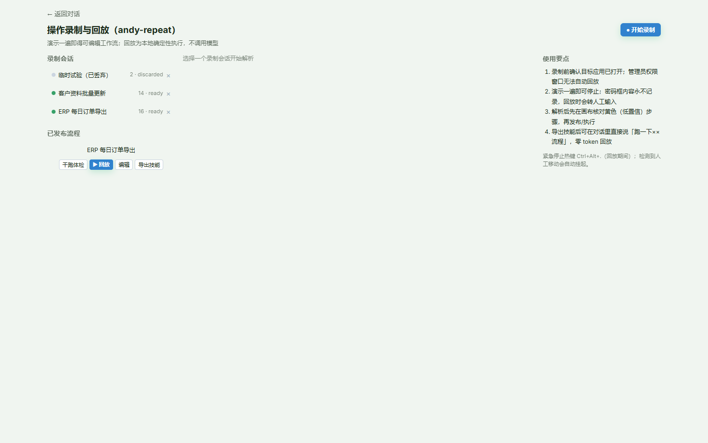
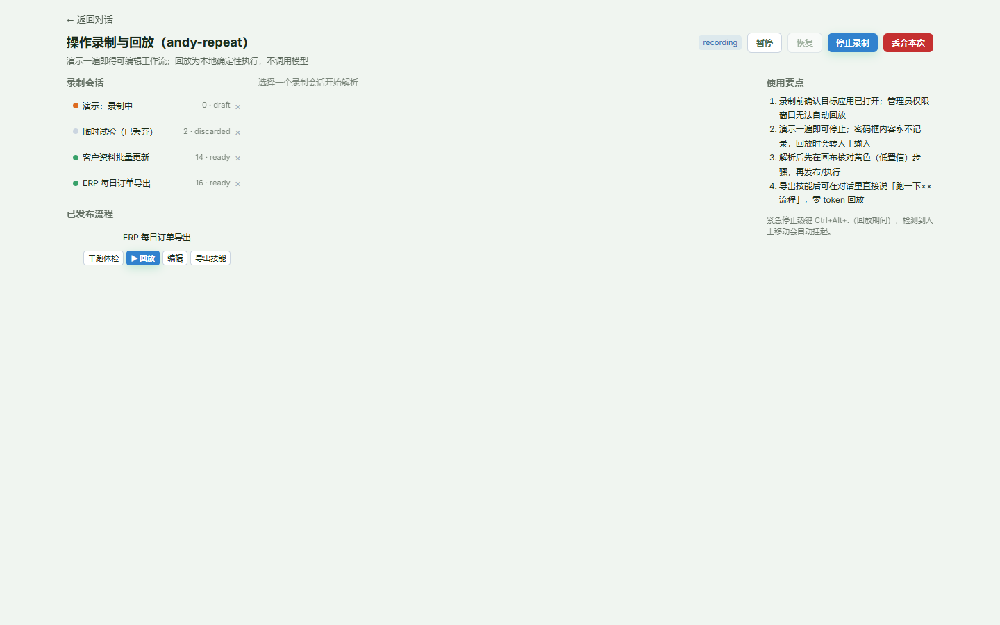
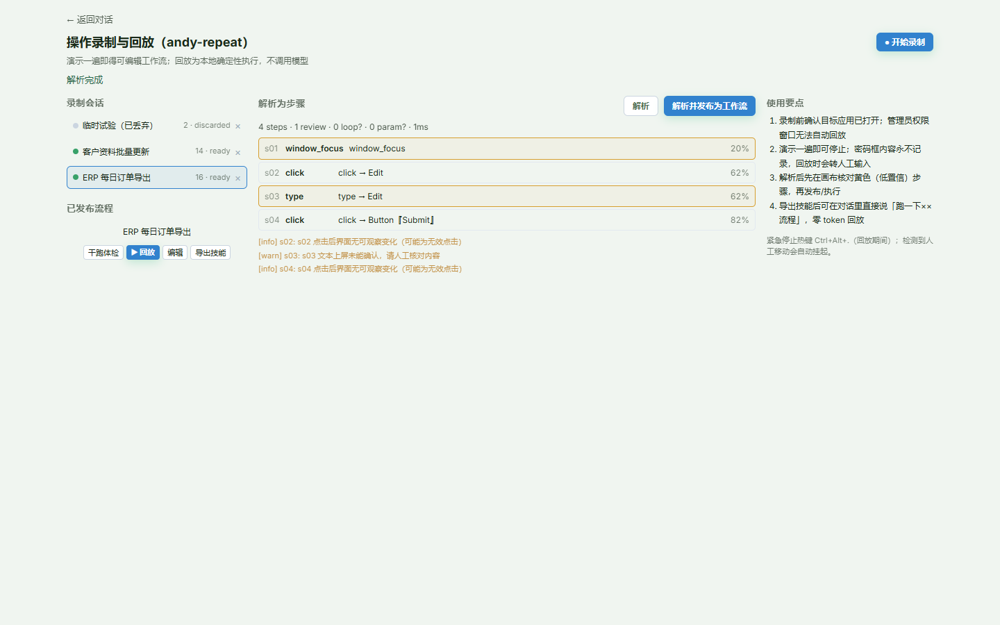
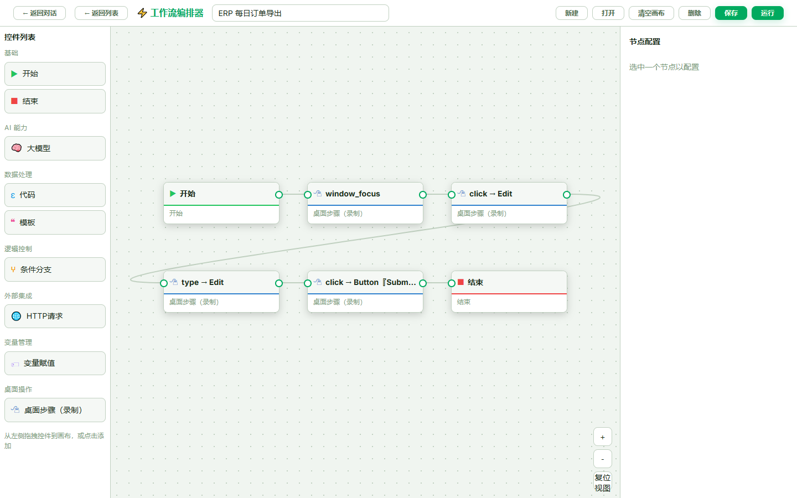
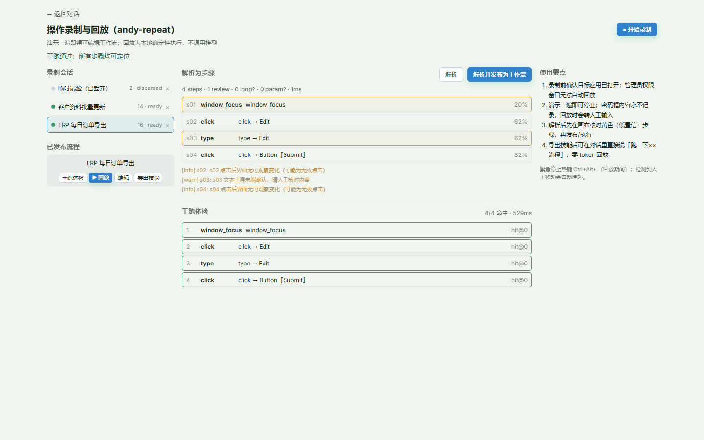
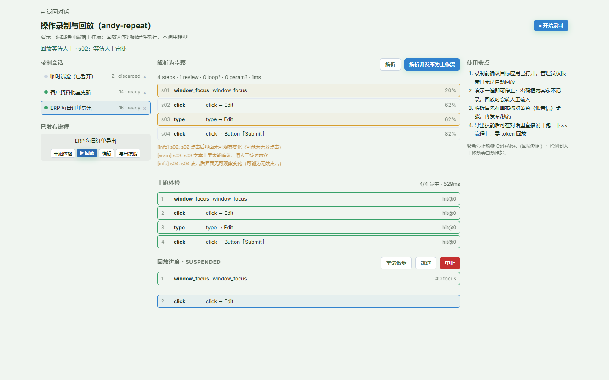
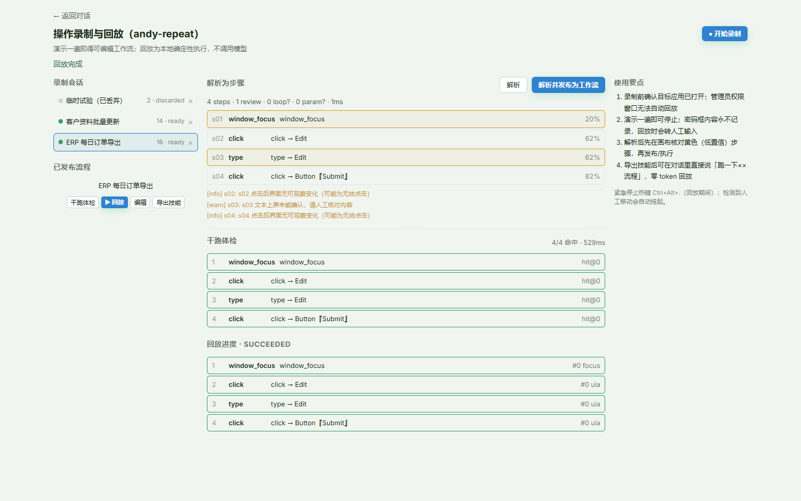

# 操作录制与回放（andy-repeat）用户操作手册

> **适用版本**：andy-harness 1.0.x（`desktop_repeat` 模块 / `andy_repeat` 插件）
> **适用系统**：Windows 10 / Windows 11（当前版本为 Windows-first）
> **手册定位**：面向终端用户，按功能模块分章，每个操作给出可照做的步骤、界面截图与注意事项。
> **实测环境**：Windows 10 19045、1920×1080 @125% 缩放、Chromium 系浏览器；全部截图来自实际运行，流程数据由真实录制产生。

---

## 目录

1. [这套功能能做什么](#一这套功能能做什么)
2. [准备工作：安装、启动与入口](#二准备工作安装启动与入口)
3. [模块一：录制桌面操作](#三模块一录制桌面操作)
4. [模块二：把录制解析为步骤](#四模块二把录制解析为步骤)
5. [模块三：发布为工作流并在画布中编辑](#五模块三发布为工作流并在画布中编辑)
6. [模块四：干跑体检（零副作用预演）](#六模块四干跑体检零副作用预演)
7. [模块五：回放执行与人工裁决](#七模块五回放执行与人工裁决)
8. [模块六：导出技能并在对话中调用](#八模块六导出技能并在对话中调用)
9. [模块七：会话与运行记录管理](#九模块七会话与运行记录管理)
10. [模块八：命令行（CLI）用法](#十模块八命令行cli用法)
11. [典型场景演练](#十一典型场景演练)
12. [注意事项与能力边界](#十二注意事项与能力边界)
13. [故障排查速查表](#十三故障排查速查表)
14. [附录](#十四附录)

---

## 一、这套功能能做什么

**一句话**：在电脑上把一段重复操作演示一遍，得到一个可编辑、可复用、**回放时不调用大模型、零 Token、断网也能跑**的桌面流程。

它记录的不是"屏幕录像"，而是三样东西：

| 记录内容 | 用途 |
|---|---|
| 结构化事件流（点击/键入/滚动/窗口切换/打点） | 还原"你做了什么、按什么顺序" |
| 点击落点的控件语义（控件类型、名称、AutomationId、结构路径） | 回放时按控件找目标，而不是死记坐标 |
| 关键帧截图（可选档位） | 失败时对照"当时长什么样 / 现在长什么样" |

因此它和"按键精灵/坐标宏"的关键差异是：

- **界面小改版仍可能跑通**：定位链按「控件语义 → 图像锚点 → 相对位置 → 坐标」逐级降级；
- **回放不烧 Token**：执行完全本地确定性完成，AI 只在"解析命名"和"失败修复建议"两个可选环节出现；
- **有安全护栏**：危险动作（删除/支付/提交等）与越界窗口会被拦截或转人工，不会"闭眼乱点"。

---

## 二、准备工作：安装、启动与入口

### 2.1 安装桌面依赖

录制需要全局输入钩子、UIA 控件查询与截图能力，它们属于可选依赖：

```bash
cd backend
uv sync --extra repeat
# 或者：pip install "harness[repeat]"
```

> 💡 依赖缺失时不会影响系统其它功能：入口页会显示"录制回放不可用"，插件仍保持激活但工具返回明确的降级提示。

### 2.2 启动前后端

在项目根目录双击 `start-all.bat`（后端 `127.0.0.1:8000` + 前端 `127.0.0.1:5173`）。

若 8000 端口已被其它程序占用，可以换端口启动（前端代理目标支持环境变量覆盖）：

```bat
:: 后端换到 8010
cd backend
.venv\Scripts\python.exe -m uvicorn harness.main:app --host 127.0.0.1 --port 8010

:: 前端代理指向 8010，并换到 5174
cd frontend
set VITE_BACKEND_TARGET=http://127.0.0.1:8010
set VITE_PORT=5174
pnpm exec vite --host 127.0.0.1 --port 5174
```

### 2.3 打开入口

浏览器访问 `http://127.0.0.1:5173/repeat`，或在对话页左下角「更多功能」中点击 **操作录制回放**。



界面分三栏：

| 区域 | 内容 | 你会用它做什么 |
|---|---|---|
| 左栏 | **录制会话**列表 + **已发布流程**列表 | 选择要解析的会话；对流程执行干跑/回放/编辑/导出技能 |
| 中栏 | 解析结果 / 干跑报告 / 回放进度 | 查看每一步的动作、置信度、命中情况 |
| 右栏 | 使用要点 | 随时提醒关键约束（提权窗口、热键、复核低置信步骤） |

> ⚠️ **开始前请确认**：目标应用已启动、窗口没有被最小化到不可交互状态；如果目标应用是"以管理员身份运行"的，普通权限的 harness 无法操作它（系统 UIPI 限制，见 §12.1）。

---

## 三、模块一：录制桌面操作

### 3.1 开始录制

1. 点击右上角 **● 开始录制**。
2. 在弹出的输入框中给流程起名（例如「ERP 每日订单导出」），点确定。
3. 屏幕出现 3-2-1 倒计时（倒计时期间的操作不会被记录），随后角落出现红点状态胶囊，表示开始采集。

> 💡 倒计时用于留出切换窗口的时间。若希望立即开始，可在设置中把 `countdown_s` 调为 0。
> ⚠️ 录制期间请**不要在管理员权限窗口中操作**：钩子与 UIA 都受 UIPI 限制，录进去也回放不了。

### 3.2 完整演示一遍流程

按你平时的方式操作即可：打开菜单、点击按钮、输入内容、切换窗口、滚动列表……

录制器会自动完成这些事：

- 每次点击记录落点坐标 + **点击时刻的控件语义**（控件类型/名称/AutomationId/结构路径）；
- 连续键入合并成一段文本（中文输入法上屏的内容也能正确归并）；
- 窗口切换记录为"窗口焦点"事件；
- 需要等待的间隔会体现在时间轴上，解析时用于推断等待点。

### 3.3 暂停、恢复、打点与丢弃（热键）

| 热键 | 作用 | 说明 |
|---|---|---|
| `Ctrl+Alt+P` | 暂停 / 恢复 | 暂停区间内的操作**完全不采集**；密码框等敏感窗口也会触发自动暂停 |
| `F10` | 打点标记 | 在流程中插入一个"分段标记"，解析后是一个无副作用的 marker 步骤 |
| `Ctrl+Alt+R` | 结束录制 | 与页面上的"停止录制"等效 |
| `Ctrl+Alt+X` | 丢弃本次 | **需在 3 秒内连按两次**确认；丢弃后不生成流程 |

页面上的按钮与热键等效：



- 顶部胶囊显示当前状态（`recording` / `paused`）；
- 「暂停」在录制中可用，「恢复」仅在暂停时可用；
- 「停止录制」封版并保存；「丢弃本次」直接丢弃，不产生流程。

> 💡 录制状态的刷新是自动的：即使用热键结束，页面也会在约 3 秒内同步为"已结束"并刷新列表，不需要手动刷新。

### 3.4 隐私保护（默认开启，前置生效）

- **密码框**：控件被识别为密码框后，键入内容**永不落盘**，只记录"输入了 N 个字符"；解析后该步骤变成"人工确认"节点，回放时暂停等你输入。
- **屏蔽窗口**：可在录制配置里填写窗口标题正则（`mask_windows`），命中窗口不截图、不查询控件。
- **屏蔽按键组合**：`mask_keys` 中的组合键不记录内容。
- **数据全本地**：事件流、帧、锚点都存在本机工件目录，不上传任何服务器。

### 3.5 停止录制与封版

1. 点击 **停止录制**（或按 `Ctrl+Alt+R`）。
2. 系统自动做完整性校验（事件非空、清单 SHA256 一致），状态变为 `ready`。
3. 左栏会话列表出现新会话，并显示事件数与状态点颜色：

| 状态点 | 含义 |
|---|---|
| 橙色 `draft` | 正在录制（或异常中断留下的草稿） |
| 绿色 `ready` | 已封版，可解析/回放 |
| 红色 `failed` | 录制失败（如未采集到事件），原始数据保留供排查 |
| 灰色 `discarded` | 已丢弃（保留回收标记，不生成流程） |

> ⚠️ 如果误点了"丢弃"，该会话不会出现在可解析列表里；如需找回，可到工件目录的 `runtime/discarded_at` 标记旁手动恢复（当前版本不会自动清理已丢弃目录，见 §14.3）。

---

## 四、模块二：把录制解析为步骤

### 4.1 解析

1. 在左栏点击要解析的会话（例如「ERP 每日订单导出」）。
2. 中栏出现「解析为步骤」工具栏，点击 **解析**。
3. 等待约 1 秒，出现步骤列表与统计。



### 4.2 怎么看解析结果

顶部统计一行：

```
4 steps · 0 review · 0 loop? · 0 param? · 1ms
```

| 字段 | 含义 | 建议 |
|---|---|---|
| `steps` | 解析出的步骤数 | — |
| `review` | 需要人工确认的步骤数 | 大于 0 时逐条核对 |
| `loop?` | 疑似循环的组数 | 可在画布中改成循环，或保留展开 |
| `param?` | 被识别为"可变参数"的数量 | 如日期/邮箱/路径，回放时可传值覆盖 |

步骤卡片右侧的百分比是**置信度**：

- **绿色/普通边框**：置信度 ≥ 50%，定位链首通常能命中；
- **黄色边框**：置信度 < 50% 或标记了"需人工确认"（例如采集时 UIA 超时、输入法上屏未能确认、命中危险词库）。

> 💡 黄色卡片不是"错误"，而是"提醒你复核"。常见处理：到画布把该步骤的说明改清楚，或回到目标应用重新录一次这一段。

### 4.3 警告信息的读法

列表下方的 `[info]/[warn]` 行是解析器给出的诊断，常见几类：

| 代码 | 含义 | 处理建议 |
|---|---|---|
| `CP-NOUIA` | 点击时没拿到控件语义（UIA 超时/不支持） | 该步只剩图像/坐标兜底，建议重录该段或确认目标应用可访问性 |
| `CP-IME` | 文本上屏未能确认（中文输入法差异） | 回放前先干跑；必要时把步骤改成"人工确认" |
| `CP-NOOP` | 点击后界面没有可观察变化（疑似无效点击） | 多为误点，可在画布删除该步骤 |
| `CP-RISK` | 目标命中危险词库（删除/支付/提交…） | 默认转人工确认，不要改成自动放行 |
| `CP-LOOP` | 连续相似操作，疑似循环 | 可参数化/循环化，减少步骤数 |
| `CP-PAUSE` | 已扣除暂停区间 | 仅提示，无需处理 |

### 4.4 参数化（可选）

当键入内容符合日期、时间、金额、邮箱、手机号、数字、URL、Windows 路径等模式时，解析器会自动把它提升为参数（`{{param.xxx}}`），录制时的值作为默认值。

回放时可以：

- 不传参 → 用默认值（即录制时的值）；
- 传参 → 覆盖默认值（见 §7.2）。

> ⚠️ 参数默认值会随流程定义一起保存（在工作流定义/画布中可见）。如果内容是敏感信息，请把它改成"每次人工输入"（`source=runtime_only`）或在录制时使用屏蔽窗口。

### 4.5 视觉辅助核对（可选，默认关闭）

解析完成后，可以让一个视觉大模型**回看每一步的前后两张关键帧**，判断这一步到底有没有生效，并给出"疑似未生效"清单。这是**纯旁路**能力：不参与编译、不改写步骤、失败也不影响主链路。

**它解决的问题**：某些步骤在事件流层面完全正常（点击命中、无报错），实际上界面却没发生变化——例如弹出了未预期的对话框、点了不可点的区域、输入落在了错误控件。只看步骤文本很难发现，看前后帧才能判断。

**开启方式**（插件配置 `repeat.*` 或环境变量 `HARNESS_REPEAT_VISION_ENABLED=1`）：

| 配置项 | 默认值 | 说明 |
|---|---|---|
| `repeat.vision_enabled` | `false` | 总开关。关闭时解析后不再触发，也不产生任何外网请求 |
| `repeat.vision_model` | `qwen3-vl-plus` | 阿里百炼视觉模型名 |
| `repeat.vision_base_url` | `https://dashscope.aliyuncs.com/compatible-mode/v1` | OpenAI 兼容端点；如使用北京地域专属端点，改这一项即可 |
| `repeat.vision_api_key` | 空 | 留空时依次回退：`DASHSCOPE_API_KEY` 环境变量 → 项目根 `key.txt` |
| `repeat.vision_max_steps` | `24` | 单次分析步数上限（1–200），用于控制 token 成本 |
| `repeat.vision_timeout_s` | `60` | 单步分析超时（5–300 秒） |

> 🔑 **密钥安全**：优先用环境变量，其次项目根 `key.txt`（自动按 `sk-...` 正则提取）。密钥**不会**写入日志、数据库或会话产物；`vision.json` 里只有模型名和分析结论。

**怎么触发**

- 自动：开启后，每次解析（§4.1）会在后台异步跑一次，结果落盘后自动回写会话；
- 手动：

```http
POST /api/desktop-repeat/sessions/<sid>/vision   # 触发（异步，立即返回 started=true）
GET  /api/desktop-repeat/sessions/<sid>/vision    # 查询结果
```

**怎么看结果**

产物在会话目录下 `vision.json`，同时挂在 `session.json` 的 `vision` 字段：

| 字段 | 含义 |
|---|---|
| `analyzed` | 实际分析了多少步（前后帧齐全才会分析，缺帧自动跳过以省 token） |
| `skipped_no_frames` | 因关键帧不足而跳过的步数 |
| `failed` | 分析失败/超时的步数（不影响回放） |
| `steps[].screen_changed` | 该步前后画面是否发生变化 |
| `steps[].effective` | 模型判定该步是否生效 |
| `steps[].issues` | 具体问题（如"点击后无变化""疑似弹出了对话框"） |
| `suspects[]` | **疑似未生效的步骤清单**，优先复核这些 |

> 💡 建议工作流：先跑一次干跑体检（§6）→ 再看 `suspects` → 对列出的步骤重点复核或重录该段。模型结论仅供参考，**判定以实际回放为准**。

---

## 五、模块三：发布为工作流并在画布中编辑

### 5.1 发布

在中栏点击 **解析并发布为工作流**，系统会：

1. 再次编译并做静态校验（非法步骤会直接报错，不会写入）；
2. 生成一个 `gui` 节点序列的工作流；
3. 自动跳转到工作流画布 `/workflows/<id>`。

### 5.2 画布中的录制流程



- 紫色/蓝色节点为「桌面步骤（录制）」，标题即步骤说明（如 `click → Edit`、`type → Edit`）；
- 左侧「控件列表 → 桌面操作」可以把新的桌面步骤拖进画布（用于手工补步骤）；
- 选中节点后，右侧可修改**步骤说明**，并只读查看动作、风险等级、定位器数量与链顺序；
- 节点可拖动、连线，和普通工作流节点一样保存/运行。

> 💡 录制流程的**定位链维护仍然在录制工作台**（重新录制或调整解析结果）。画布侧重"编排与说明"：调整步骤顺序、删除误点、插入等待/条件分支。
> ⚠️ 画布上的「运行」与工作台里的「回放」走同一套执行器与安全护栏：危险动作仍需人工确认。

---

## 六、模块四：干跑体检（零副作用预演）

### 6.1 什么时候做

**每次回放前都建议先干跑**，尤其是：界面刚升级过、换了显示器/缩放比例、目标应用重装过、距离上次成功回放超过一周。

### 6.2 操作步骤

1. 在左栏「已发布流程」中找到目标流程；
2. 点击 **干跑体检**；
3. 等待报告出现（通常几百毫秒）。



### 6.3 怎么读报告

- 顶部 `4/4 命中 · 249ms`：4 个步骤全部能定位到目标；
- 每行 `hit@0`：命中定位链的**第 1 个**策略（0 基），说明最稳的 UIA 语义定位有效；
- `hit@2` / `hit@3`：前两级失效，降级到图像/相对/坐标，**能跑但更脆**，建议找时间重录；
- `miss` + 错误码：该步当前找不到目标，**不要直接回放**，按提示处理（见 §13）。

> 💡 干跑只做"定位解析"，**不点击、不输入、不产生任何副作用**，可以放心在真实业务界面上执行。
> ⚠️ 干跑通过不代表一定能跑通：运行时还受焦点、弹窗、权限、人工干预等影响；它只能排除"目标找不到"这一类问题。

---

## 七、模块五：回放执行与人工裁决

### 7.1 启动回放

1. 在左栏流程行点击 **▶ 回放**；
2. 第一次回放会弹出"缺参数"提示（若该流程有必填/运行时参数）——按提示填写，见 §7.2；
3. 页面出现「回放进度」面板，同时桌面开始自动操作。

> ⚠️ **回放期间请不要移动鼠标、不要敲键盘**。系统会检测真实输入（RP-7002），一旦发现就暂停并等你确认，避免"人和机器抢鼠标"。
> 💡 紧急停止：任何时候按 **`Ctrl+Alt+.`**（句号），或在进度面板点 **中止**。

### 7.2 参数怎么填

缺参时弹出的输入框支持两种写法：

1. **键值对**：`cust_name=张三, date=2026-10-19`
2. **按顺序只填值**：`张三, 2026-10-19`（按缺参清单的顺序对应）

> 💡 提示文案里带 `*` 的是必填项；不带 `*` 的可留空使用默认值。
> ⚠️ 无人值守（定时任务/对话调用）遇到"每次必须人工提供"的参数会**直接拒绝启动并返回清单**，不会挂起等待。

### 7.3 人工审批（交互模式）

默认情况下，第一次"写操作"（点击、输入、拖拽等会改变界面状态的动作）会触发人工审批：



- 顶部提示：`回放等待人工 · s02: 等待人工审批`；
- 进度面板状态：`SUSPENDED`；
- 三个按钮：

| 按钮 | 作用 | 适用场景 |
|---|---|---|
| **重试** | 授权并继续执行该步骤（同一轮运行内后续写操作不再重复询问） | 确认目标正确，继续跑 |
| **跳过** | 跳过该步骤，继续下一步 | 该步已手工完成，或当前不重要 |
| **中止** | 立即终止本次回放 | 目标不对/不想继续 |

> 💡 危险动作（命中"删除/支付/提交/格式化"等词库）**每次都会重新确认**，不会被"重试一次"永久放行。
> ⚠️ 如果你点「重试」后什么都没发生，并再次看到"等待人工"，请确认没有被其它窗口抢焦点；必要时点「跳过」。

### 7.4 回放完成



- 状态变为 `SUCCEEDED`；
- 每行显示 `#0 uia`（命中第 1 个定位器、UIA 语义定位）或 `#0 focus`（窗口焦点步骤）；
- 顶部提示变为「回放完成」。

如果某步失败：

- 状态可能是 `FAILED` 或 `SUSPENDED`，步骤行会标红并给出错误码（如 `RP-2001` 定位链耗尽、`RP-3002` 断言失败、`RP-4001` 权限不足）；
- 失败瞬间会在运行目录生成**诊断包**（全屏截图、锚点、定位尝试清单），用于对照修复；
- 处理方式：查看错误码（§14.1）→ 修复界面/权限/参数 → 重新干跑 → 再回放。

### 7.5 人工接管

回放过程中只要检测到**真实鼠标移动/键盘输入**，就会自动挂起并提示"检测到人工介入，已暂停"。

- 想继续：点 **重试**（或按提示恢复），系统会从当前步骤继续；
- 想放弃：点 **中止**；
- 这是"宁可停下也不乱点"的保护，不是故障。

---

## 八、模块六：导出技能并在对话中调用

### 8.1 导出

在流程行点击 **导出技能**，系统会在用户技能目录生成：

```
<用户技能目录>/repeat-<slug>/
├── SKILL.md          # 技能说明、参数表、版本绑定的 graph 哈希
└── scripts/check.py  # 可选前置检查
```

页面顶部会提示导出目录。

### 8.2 在对话中使用

导出后，直接在对话里说：

> 跑一下我录的「ERP 每日订单导出」流程

模型会命中该技能并调用 `repeat_run` 工具，按技能里绑定的 `workflow_id` + `graph_sha256` 执行：

- 版本不一致（流程被改过）会拒绝执行，提示重新导出技能；
- 缺参数会返回清单，模型会先问你，不会自己编值；
- 执行过程仍是本地确定性回放，**不消耗 Token**。

> 💡 同一流程也可以挂到「定时任务」里，按计划自动回放（无人值守模式，危险动作转待办/拒绝）。

---

## 九、模块七：会话与运行记录管理

### 9.1 会话列表

- 每个会话显示：名称、事件数、状态点；
- 点击会话选中，中栏出现解析入口；
- `×` 删除会话（同时删除其工件目录，不可恢复）；
- 正在录制的会话不允许删除，需先停止。

### 9.2 运行记录

- 回放产生的运行记录写入数据库（`repeat_runs` / `repeat_step_hits`），包含每步命中策略、耗时、状态、错误码；
- 运行结束后可通过 API / 命令行 `inspect <run_id>` 查看；
- 命中率统计用于识别"某步总是降级到图像/坐标"的脆弱流程，建议据此重录。

> 💡 会话与运行记录都只存在本机（SQLite + 工件目录），不会上传。

---

## 十、模块八：命令行（CLI）用法

适合不启动前端、或在脚本/CI 中使用的场景。命令在 `backend` 目录下执行：

```bash
# 开始录制（独立进程，Ctrl+Alt+P 暂停 / Ctrl+Alt+X 丢弃）
python -m harness.modules.desktop_repeat.cli record --label "每日导出" --tier standard

# 结束录制（可用 --session 指定；--discard 丢弃）
python -m harness.modules.desktop_repeat.cli record --stop --session r-20261019-101500-ab12cd

# 解析（--name 同时保存为工作流）
python -m harness.modules.desktop_repeat.cli compile r-20261019-101500-ab12cd --name "每日导出"

# 干跑体检
python -m harness.modules.desktop_repeat.cli dry-run <workflow_id> --param date=2026-10-19

# 回放（终端交互时按交互模式；管道/无人值守时自动无人值守）
python -m harness.modules.desktop_repeat.cli replay <workflow_id> --param date=2026-10-19

# 导出技能
python -m harness.modules.desktop_repeat.cli skill <workflow_id> --slug daily-export

# 查看会话/运行详情
python -m harness.modules.desktop_repeat.cli inspect <session_id 或 run_id>
```

> ⚠️ CLI 的 `record` 与 `record --stop` 是两次独立进程调用：结束时要带上 `--session`（或保证录制器仍在运行）。服务端对"已封版会话"的 stop 是幂等的，重复执行不会破坏数据。
> 💡 `--params` 也可以传一个 JSON 文件路径，适合参数较多的场景。

---

## 十一、典型场景演练

### 场景 A：ERP 每日订单导出

1. 打开 ERP → 筛选今天 → 导出 Excel → 重命名归档；
2. 录制一遍（约 30 秒）；
3. 解析 → 把日期步骤参数化（如 `{{param.date}}`）；
4. 干跑通过后发布；
5. 每天在对话里说"跑一下每日导出，日期=今天"，或挂定时任务（参数用 `today()` 派生）。

**要点**：导出按钮通常命中"危险词库"（导出/下载），首次会要求审批；确认一次后可连续跑。

### 场景 B：批量录入客户资料

1. 录制"新增客户 → 填 5 个字段 → 保存 → 关闭弹窗"；
2. 解析后检查每个 `type` 步骤的置信度（输入框是否有 UIA 锚点）；
3. 把客户名/电话/地址改成参数；
4. 干跑 → 用 2~3 组不同参数各回放一次，确认字段没有错位。

**要点**：字段多的表单最容易出现"锚到上一个输入框"的问题；如果发现错位，回到目标应用重新录这一段，别硬改坐标。

### 场景 C：跨应用搬运数据

1. 录制：从 A 系统复制单号 → 切到 B 系统查询 → 粘贴 → 保存；
2. 解析后会有 `window_focus` 步骤与 `hotkey`（Ctrl+C/V）步骤；
3. 干跑确认两个窗口都能找到；
4. 回放时不要切换窗口、不要动鼠标；需要人工核对时用"跳过/中止"。

**要点**：跨应用流程对窗口标题敏感；如果应用标题会随单据变化，建议在画布中把 `window_title_regex` 放宽（例如只匹配应用名）。

---

## 十二、注意事项与能力边界

### 12.1 系统级限制（不是 Bug）

| 限制 | 说明 | 应对 |
|---|---|---|
| **UIPI 权限隔离** | 普通权限进程无法操作"以管理员运行"的窗口（钩子与 UIA 都受限） | 以管理员身份启动 harness，或把该步改为人工确认 |
| **UAC 安全桌面** | UAC 弹窗在独立桌面，钩子不可达 | 录制/回放遇到时人工处理，流程中插入"人工确认" |
| **锁屏 / 远程断开** | 没有图形会话时无法回放 | 执行前会检测并报 `RP-1001`，解锁后重试 |
| **DPI 缩放** | 换缩放比例/换显示器会让坐标类定位漂移 | 干跑会显示环境漂移等级；尽量在录制时的显示配置下回放 |
| **输入法** | 逐字符键入可能被中文输入法劫持 | 文本优先走 UIA `SetValue` 或剪贴板粘贴，不依赖逐字符键入 |
| **Chromium/Electron** | 未开启无障碍时 UIA 属性可能稀疏 | 解析会给出 `CP-NOUIA` 警告并降级到图像/坐标；建议重录或改用有语义的控件 |
| **反自动化应用** | 部分游戏/网银禁止钩子/注入 | 不做对抗；检测到即停止，请人工操作 |

### 12.2 使用纪律

- 回放期间**不要动鼠标键盘**；需要干预时先按 `Ctrl+Alt+.` 或点「中止」。
- 不要把"删除/支付/发送"等危险步骤改成自动放行；确需无人值守时，先在小范围验证。
- 录制前关闭无关弹窗/通知，避免把"通知点击"录进流程。
- 流程变更（界面改版、字段增减）后**先干跑**，不要直接回放。
- 敏感流程使用屏蔽窗口/密码框录制，不要把明文密码写进参数默认值。

### 12.3 性能与容量

- 关键帧档位：`minimal`（不存帧，最快）/ `standard`（裁剪帧，默认）/ `forensic`（全屏帧，最大）；
- 单个会话默认上限 500 MB，超限后停止存帧（事件不受影响）；
- 帧可按保留天数清理（默认 standard 30 天 / forensic 7 天，由维护任务调用 `gc`），事件与清单保留更久；
- 长流程（数百步）建议拆成多个流程，用工作流编排串联。

---

## 十三、故障排查速查表

| 现象 | 可能原因 | 处理 |
|---|---|---|
| 入口显示"录制回放不可用" | 未安装 `repeat` 依赖 | `cd backend && uv sync --extra repeat`，重启后端 |
| 点"开始录制"没反应/报 503 | 插件未激活或桌面依赖缺失 | 看后端日志中 `andy-repeat` 激活信息；确认在带图形会话中运行 |
| 录制结束事件数为 0 | 倒计时内没有操作 / 钩子被安全软件拦截 | 等状态变为 `recording` 再操作；把 harness 加入杀软白名单 |
| 会话状态是 `failed` | 未采集到事件或清单校验失败 | 查看会话详情里的 `error`；原始数据已保留可排查 |
| 解析报"未封版" | 会话还是 `draft`（录制未正常结束） | 先停止录制；若录制器已崩溃，重启后重新录 |
| 解析后大量黄色卡片 | UIA 超时/输入法风险/危险词 | 逐条复核；必要时重录该段 |
| 干跑 `miss`（`RP-2001`） | 界面改版/窗口标题变化/应用未启动 | 启动应用、放宽 `window_title_regex`、重录 |
| 干跑 `miss`（`RP-2006`） | 环境漂移导致坐标兜底被闸门禁用 | 恢复录制时的分辨率/缩放，或显式允许盲坐标（不推荐） |
| 回放一启动就"检测到人工介入" | 旧版本把启动点击误判为干扰 | 本版本已修复；若仍出现，点「重试」且不要动鼠标 |
| 点「重试」后仍反复挂起 | 旧版本审批 token 为空导致授权失败 | 本版本已修复；确认后端已更新并重启 |
| 回放卡在某步不动 | 目标应用忙/等待超时 | 看错误码；必要时中止后重跑 |
| 保存/另存为对话框里点不动（`RP-1007`） | 旧版本把"主窗口被模态框禁用"一律判为遮挡并挂起 | 本版本已改为：只在**取不到前台窗口**时才判真遮挡；同进程对话框会自动接管继续回放；取不到同进程模态面时降级放行（禁用盲坐标）。请确认后端已更新并重启 |
| 弹窗标题与录制时不一致导致拒写（`RP-4002`） | 窗口按 exe 兜底命中了"错误但存在"的窗口 | 本版本对无 class 的 exe 兜底仍严格校验标题；若对话框有稳定 class，会以 class 精确命中作为强证据放行 |
| 对话框弹出慢，步骤扑空 | 旧版本不等待目标窗口出现 | 本版本会等待目标窗口出现（默认 2.5 秒），可用 `repeat.window_appear_wait_ms` 调整 |
| 浏览器里输完网址不回车、卡在 hotkey 步骤（`RP-2001`/`RP-2002`） | 锚点绑到了"按下按键后才出现的页面"，因果倒置 | 本版本 hotkey 定位链耗尽时自动降级为**焦点注入**（真跑与干跑一致），无需重录；若仍异常再检查该步窗口作用域 |
| 文本输错/重复/乱码 | 输入法或控件过滤 | 先干跑；把该步改为剪贴板粘贴或人工确认；重录该段 |
| 管理员窗口无法回放（`RP-4001`） | UIPI 限制 | 以管理员身份运行 harness，或改为人工步骤 |
| 回放期间鼠标一动就停 | 人工接管保护（`RP-7002`） | 点「重试」继续；回放期间不要操作 |
| 热键无效 | 旧版本 AltGr 组合识别问题 | 本版本已修复；确认版本，或改用页面按钮 |
| 停止录制后页面仍显示"录制中" | 旧版本未同步热键结束状态 | 本版本已自动同步；手动刷新页面可立即恢复 |
| 删除会话报 404 | 会话已不存在（列表过期） | 刷新列表即可 |
| 工作流画布打开是空白 | 旧版本缺 `gui` 节点定义 | 本版本已支持；确认前端已重新构建 |

---

## 十四、附录

### 14.1 常用错误码

| 错误码 | 含义 | 典型处理 |
|---|---|---|
| `RP-1001` | 无图形会话（锁屏/远程断开/非交互桌面） | 解锁、恢复远程桌面后重试 |
| `RP-1002` | 目标应用未运行 | 启动目标应用再回放 |
| `RP-1004/1005` | 显示器拓扑/缩放变化 | 恢复录制时显示配置 |
| `RP-1006` | 目标应用无响应 | 结束卡死进程后重试 |
| `RP-1007` | 模态框遮挡（当前仅当**取不到前台窗口**时才判定） | 多为主窗口被系统级/跨进程弹窗卡死；关闭弹窗后重试。同进程对话框（如「另存为」）已自动接管，不再报此码 |
| `RP-2001` | 定位链全部失效 | 重录/放宽窗口匹配/更新定位链；`hotkey` 步骤会自动降级为焦点注入 |
| `RP-2005` | 目标控件不可用（禁用/不可见） | 等待界面就绪后重试 |
| `RP-2006` | 坐标兜底被环境闸门禁用 | 恢复环境或显式允许盲坐标 |
| `RP-3002` | 断言失败（值不符合预期） | 检查输入通道/控件读回 |
| `RP-3003` | 步骤/运行超时 | 增大超时或拆步骤 |
| `RP-4001` | UIPI 权限不足 | 提升 harness 权限或转人工 |
| `RP-4002` | 安全策略拦截（越界窗口/未知动作） | 检查 `app_hint` 作用域 |
| `RP-4003/4004` | 待审批/密码需人工 | 在页面裁决或人工输入 |
| `RP-5003` | 输入结果与预期不一致 | 改用剪贴板/人工；检查输入法 |
| `RP-5004` | 输入租约被占用（录制/回放互斥） | 结束当前录制/回放再试 |
| `RP-6001` | 会话不存在/清单校验失败 | 重新录制；不要手改事件文件 |
| `RP-6004` | 流程定义非法/参数非法/版本不一致 | 重新解析/发布；重新导出技能 |
| `RP-7001` | 用户紧急停止 | 正常中止，无需处理 |
| `RP-7002` | 检测到人工介入 | 点「重试」继续 |
| `RP-7004` | 录制器异常退出 | 已保留已录部分；重录 |
| `RP-8001/8002/8003` | 参数缺失/格式错/无人值守需人工参数 | 按清单补参，或改流程参数定义 |

### 14.2 热键与默认配置

| 项 | 默认值 | 说明 |
|---|---|---|
| 开始/结束录制 | `Ctrl+Alt+R` | 与页面按钮等效 |
| 暂停/恢复 | `Ctrl+Alt+P` | 暂停区间零采集 |
| 丢弃本次 | `Ctrl+Alt+X` | 3 秒内连按两次确认 |
| 分段标记 | `F10` | 解析为 marker 步骤 |
| 紧急停止回放 | `Ctrl+Alt+.` | 任何前台窗口下都生效；热键不可用时用页面「中止」或接口中止 |
| 关键帧档位 | `standard` | `minimal` / `standard` / `forensic` |
| 倒计时 | 3 秒 | 可设 0 |
| 步骤超时 | 12 秒 | 可按步骤覆盖 |
| 运行超时 | 30 分钟 | 超时自动中止 |
| 坐标闸门 | 开 | 环境漂移时禁止盲坐标点击 |
| 窗口出现等待 | 2.5 秒 | `repeat.window_appear_wait_ms`（0–10000），对话框/新窗口弹出慢时调大 |
| 视觉辅助 | 关 | `repeat.vision_enabled`；模型 `qwen3-vl-plus`、步数上限 24、超时 60 秒（详见 §4.5） |

配置位置：插件配置（`repeat.*`）或环境变量 `HARNESS_REPEAT_*`。

### 14.3 数据目录

| 内容 | 路径 |
|---|---|
| 录制会话（事件流/帧/锚点/清单） | `<工件目录>/repeat/sessions/<session_id>/` |
| 会话元信息 | 上述目录下 `session.json` |
| 原始事件流 | `events.jsonl`（追加写，崩溃可截断恢复） |
| 完整性清单 | `manifest.json`（逐文件 SHA256 + 根哈希） |
| 视觉核对产物 | 上述目录下 `vision.json`（开启 §4.5 后生成） |
| 回放诊断包 | 运行目录下 `diagnostics/<run_id>/<sid>/` |
| 运行记录 | SQLite `repeat_runs` / `repeat_step_hits` / `repeat_audit` |
| 导出技能 | `~/.andy-harness/skills/repeat-<slug>/` |

`<工件目录>` 默认由 `HARNESS_ARTIFACTS_DIR` 指定；未指定时使用后端默认工件目录。

> ⚠️ 删除会话会连同工件目录一起删除，且不可恢复；重要流程请先导出技能或备份目录。

### 14.4 Agent 工具清单（对话调用）

| 工具 | 用途 |
|---|---|
| `repeat_record_start` | 开始录制 |
| `repeat_record_stop` | 停止/丢弃录制 |
| `repeat_record_status` | 查询录制状态 |
| `repeat_compile` | 解析（可保存为工作流） |
| `repeat_list` | 列出会话/流程/运行 |
| `repeat_dry_run` | 干跑体检 |
| `repeat_run` | 回放（可带参数与版本哈希） |
| `repeat_run_status` | 查询回放状态 |
| `repeat_abort` | 中止回放 |
| `repeat_export_skill` | 导出技能 |

---

**手册结束**。如遇到本手册未覆盖的问题，请先按 §13 的速查表定位错误码，再查看运行目录下的诊断包（`report.json` / `locator_trace.json` / `actual.png`），它们通常能直接指出"哪一步、找什么、当时长什么样"。
